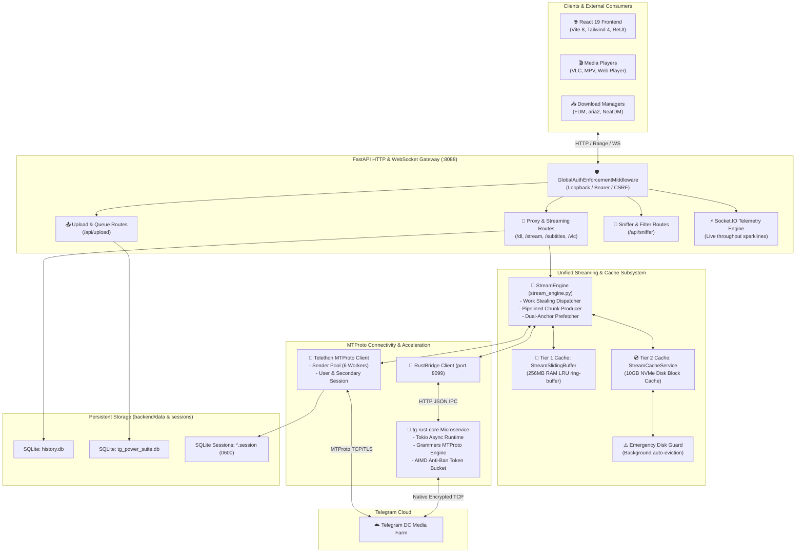

# ARCHITECTURE AFTER REMEDIATION

**Project**: TG Power Suite  
**Classification**: Hybrid Python/Rust Cloud Media Gateway & Streaming Suite  
**Date**: November 15, 2026  

---

## 1. System Overview & Component Diagram

The remediated TG Power Suite operates on a unified, high-performance hybrid architecture combining a reactive Python FastAPI gateway with a native Rust MTProto acceleration daemon.

---

## 2. Layer Separation & Boundaries

### Layer 1: Presentation & Client Consumers
- **React 19 Frontend (`frontend-reui`)**:
  - Modular component architecture leveraging Radix UI primitives and ReUI UI building blocks.
  - State decoupled between active cinema browsing, upload queue management, and live telemetry feeds.
  - Responsive docked panel design (`DockedChannelPicker` and `DockedContinueWatching`) constrained to `18% / 190px - 260px` to guarantee 0px horizontal document overflow.
- **External Media Player Bridge**:
  - VLC and MPV direct process spawning with temporary scoped capability grants (`playback_grants`), bypassing permanent secret key exposure.

### Layer 2: API Gateway & Security Perimeter
- **FastAPI / Starlette Runtime**:
  - Bound by default to `127.0.0.1:8088` (SEC-03).
  - `GlobalAuthEnforcementMiddleware` provides zero-trust boundary validation:
    - **Loopback Traffic**: Permitted without secret token when unconfigured.
    - **Remote / LAN / Tunnel / Forwarded Traffic**: Requires either valid `API_AUTH_TOKEN` (via Bearer, `X-API-Key`, or `?token=`) or verified media-scoped playback capability token.
    - **CSRF Enforcement**: Mutating requests (`POST`, `PUT`, `DELETE`, `PATCH`) validate request `Origin` against `CORS_ORIGINS` and local loopback origins.
- **Unified Range Parser**:
  - RFC 9110 compliant single-range byte parser with explicit 416 rejection for multi-range requests.

### Layer 3: Unified Streaming Core
- **Unified Engine (`stream_engine.py`)**:
  - Replaces and retires the legacy `fast_stream_engine.py`.
  - Integrates episode-aware seek generation tracking, anchor chunk prefetching, and pipelined chunk production.
  - Feeds both direct browser/player HTTP responses and FFmpeg transmuxing pipes through the same buffer and cache hierarchy.
- **2-Tier Cache Hierarchy**:
  - **Tier 1 (RAM)**: `StreamSlidingBuffer` maintaining a strict 256MB memory ceiling with bidirectional seek window retention.
  - **Tier 2 (Disk)**: `StreamCacheService` indexing 512KB media blocks up to 10GB with debounced LRU disk guard eviction.

### Layer 4: MTProto Acceleration & Connectivity
- **Rust Core Microservice (`rust_core / tg-rust-core`)**:
  - Compiled native binary listening on `127.0.0.1:8099`.
  - Employs Grammers MTProto library for ultra-low overhead byte chunk retrieval directly from Telegram Datacenters.
  - Implements AIMD anti-ban token bucket pacing to eliminate floodwait penalties.
- **Python Telethon Connection Pool**:
  - Multi-worker parallel MTProto client providing seamless fallback and multi-account turbo uploads.

### Layer 5: Data & Session Persistence
- **Secure Sessions**: Stored in `backend/sessions/` with `0700` directory and `0600` file permissions (SEC-02).
- **SQLite Databases**: Anchored strictly to `backend/data/` (`history.db`, `tg_power_suite.db`), eliminating 0-byte orphan files in workspace root.

---

## 3. Data Flow: Media Streaming Request Lifecycle

1. **Client Request**: Video player issues `GET /dl/{chat_id}/{message_id}/{filename}` with `Range: bytes=0-1048575`.
2. **Security Verification**: Middleware verifies loopback status or checks `API_AUTH_TOKEN` / `playback_token`.
3. **Range Normalization**: `parse_http_range` converts header to byte bounds `(0, 1048575)`.
4. **Cache Lookup**:
   - Engine inspects `StreamSlidingBuffer` (RAM).
   - If missing, engine checks `StreamCacheService` (Disk block).
5. **Wire Fetch**:
   - If missing from cache, request is dispatched to `tg-rust-core` on port 8099.
   - If Rust microservice is offline, gracefully falls back to Telethon worker pool.
6. **Sliding Window Storage**: Retrieved chunk is stored in RAM and disk cache for instantaneous backward/forward seeking.
7. **Piped Delivery**: HTTP 206 Partial Content response streams byte chunks to client with fine-grained CORS headers.
