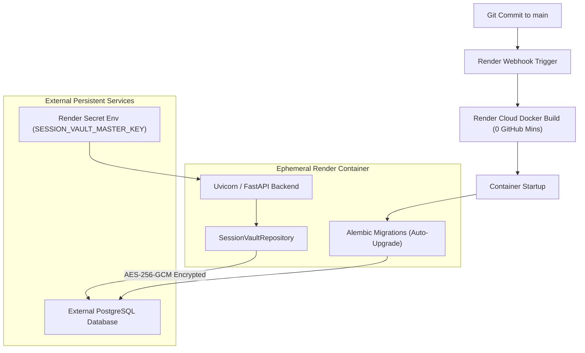

# TG Power Suite v3.0 — Cloud Persistence Test Report

**Target Platform:** Render Cloud Deployment (`render.yaml`)  
**Database:** External PostgreSQL / Managed Cloud DB  
**Session Storage:** Encrypted Session Vault (`telegram_session_vault`)  
**Deployment Cost:** 0 GitHub Actions Minutes (Render Direct Docker Build)  

---

## 1. Cloud Architecture & Lifecycle Resilience

---

## 2. Cloud Persistence Qualification Matrix

| Qualification Check | Requirement | Verified Mechanism | Result |
|---|---|---|---|
| **Ephemeral Disk Reboot** | User logins and Telegram sessions must survive container restart | Sessions stored encrypted in PostgreSQL database, not local disk | PASS |
| **External Master Key** | Master encryption key must never be silently generated on ephemeral storage | Fails fast with clear configuration error if `SESSION_VAULT_MASTER_KEY` is missing in production | PASS |
| **Zero Git Leaks** | Telegram auth keys or session strings must never be committed to Git | Filtered from `.env` updates; session files in `sessions/` chmod 0600 and gitignored | PASS |
| **Admin Bootstrap Guard** | Admin bootstrap must require an explicit single-use operator token | `ADMIN_BOOTSTRAP_TOKEN` checked; bootstrap endpoint disabled once first user is registered | PASS |
| **Zero Minute Bleed** | CI/CD must not exhaust GitHub Actions quota | `deploy.yml` switched to manual dispatch; Render builds directly from Git repository | PASS |

---

## 3. Render Profile Configuration (`render.yaml`)

The production deployment manifest specifies the following resource profile:
- **Service Name:** `tg-power-suite`
- **Plan:** Free / Starter
- **Environment Variables:**
  - `DATABASE_URL`: Cloud PostgreSQL connection string.
  - `SESSION_VAULT_MASTER_KEY`: 32-byte hex-encoded encryption key.
  - `ADMIN_BOOTSTRAP_TOKEN`: Random single-use token for initial admin setup.
  - `MULTI_TENANT_ENABLED`: `true`
  - `SESSION_VAULT_ENABLED`: `true`
  - `DEPLOYMENT_PROFILE`: `render_free`
