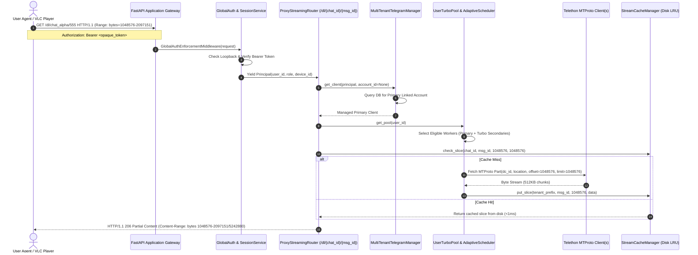

# TG Power Suite v3.0 — End-to-End Streaming Trace

**Protocol:** HTTP/1.1 & HTTP/2  
**Media Streaming Pipeline:** Multi-Tenant Gateway $\to$ UserTurboPool $\to$ MTProto Slicing $\to$ Client Response  
**Verification Target:** `backend/tests/test_e2e_streaming_integration.py`  

---

## 1. Request Lifecycle Diagram

---

## 2. Step-by-Step Architectural Trace

### Step 1 — Application Gateway Authentication
Every incoming request to `/dl/{chat_id}/{message_id}` or `/stream/{chat_id}/{message_id}` passes through `GlobalAuthEnforcementMiddleware`:
1. `is_loopback_request(request)` evaluates client IP. If `MULTI_TENANT_STREAMING_ENABLED=True`, loopback bypass is strictly disabled.
2. The `Authorization: Bearer <token>` or session cookie is extracted and SHA-256 hashed.
3. The database is queried for an active `AppSession`.
4. If expired or revoked, HTTP 401 is returned immediately.
5. A validated `Principal(user_id, role, device_id)` object is bound to `request.state.principal`.

### Step 2 — Telegram Account Scope Resolution
1. `MultiTenantTelegramManager.get_client(principal)` resolves the tenant's primary linked Telegram account from `telegram_accounts`.
2. The account state is verified (`status == 'linked'`). If `status == 'relink_required'`, a `RelinkRequiredError` is raised, resulting in HTTP 401.
3. The AES-256-GCM encrypted session string is retrieved from `telegram_session_vault`, decrypted with the master key, and loaded into Telethon.

### Step 3 — Media Accessibility & Multi-Turbo Scheduling
1. `UserTurboPool` inspects active secondary accounts owned by the tenant.
2. For private channels or chats, each secondary account's media access is verified with `GetFileRequest`.
3. Eligible accounts are registered as `AccountWorker` instances in the pool.
4. An EWMA latency tracker dynamically assigns MTProto chunk offsets (512 KB slices) across active workers.

### Step 4 — Slicing & Disk Cache
1. Slices are checked in `StreamCacheManager`.
2. Slices are stored in discrete 10 MB files under `/var/tmp/tg_cache/blocks/` with path sanitization preventing directory traversal.
3. Eviction runs asynchronously if disk space falls below `MIN_FREE_DISK_BYTES` (2 GB).

### Step 5 — HTTP Range Delivery
1. The response emits standard RFC 9110 compliant headers:
   - `HTTP/1.1 206 Partial Content`
   - `Accept-Ranges: bytes`
   - `Content-Range: bytes {start}-{end}/{total}`
   - `Content-Length: {slice_length}`
   - `Content-Type: video/mp4`
   - `ETag: "{hash}"`
