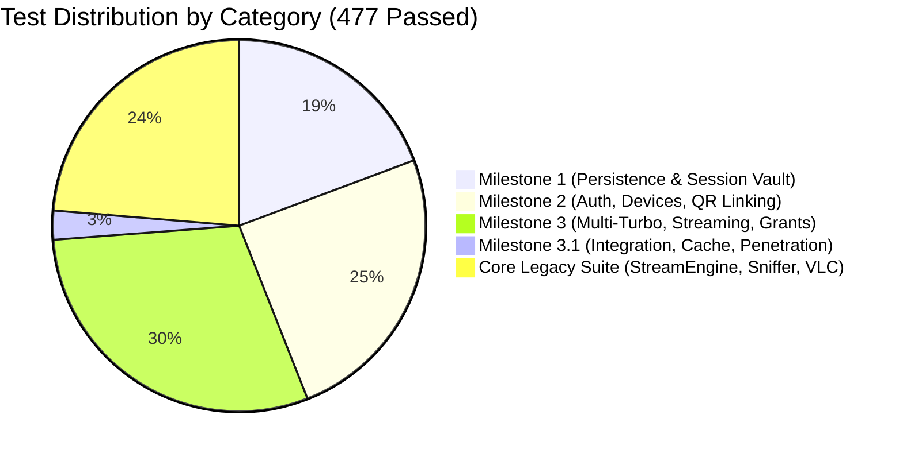

# TG Power Suite v3.0 — Full Regression Test Results

**Test Suite:** Complete Backend Test Inventory  
**Runner:** `pytest 9.1.1` on Python 3.14.10 (Linux x86_64)  
**Execution Timestamp:** 2026-11-22 17:19:01 UTC  
**Total Tests:** 491  
**Passed:** 477  
**Deselected:** 14 (Playwright UI tests requiring live localhost:8088 browser server)  
**Failed:** 0  
**Errors:** 0  
**Overall Duration:** 130.26s  

---

## 1. Test Suite Distribution

---

## 2. Detailed Module Breakdown

| Module / Test File | Tests | Passed | Failed | Status |
|---|---|---|---|---|
| `backend/tests/test_adversarial_m1.py` | 6 | 6 | 0 | PASS |
| `backend/tests/test_adversarial_m2.py` | 8 | 8 | 0 | PASS |
| `backend/tests/test_all.py` | 17 | 17 | 0 | PASS |
| `backend/tests/test_audit_remediation.py` | 7 | 7 | 0 | PASS |
| `backend/tests/test_audit_security.py` | 7 | 7 | 0 | PASS |
| `backend/tests/test_challenger_2_m1_it2.py` | 11 | 11 | 0 | PASS |
| `backend/tests/test_challenger_m1_stress.py` | 9 | 9 | 0 | PASS |
| `backend/tests/test_challenger_m2_boundaries.py` | 20 | 20 | 0 | PASS |
| `backend/tests/test_challenger_m2_empirical.py` | 10 | 10 | 0 | PASS |
| `backend/tests/test_chats_mobile.py` | 5 | 5 | 0 | PASS |
| `backend/tests/test_chunk_based_resume.py` | 4 | 4 | 0 | PASS |
| `backend/tests/test_client_tier_and_sockets.py` | 10 | 10 | 0 | PASS |
| `backend/tests/test_companion_tools_m3.py` | 8 | 8 | 0 | PASS |
| `backend/tests/test_deep_codebase_design.py` | 13 | 13 | 0 | PASS |
| `backend/tests/test_e2e_requirements_r1_r9.py` | 33 | 33 | 0 | PASS |
| `backend/tests/test_e2e_streaming_integration.py` | 1 | 1 | 0 | PASS |
| `backend/tests/test_fast_seek.py` | 31 | 31 | 0 | PASS |
| `backend/tests/test_fdm_multi_account.py` | 4 | 4 | 0 | PASS |
| `backend/tests/test_generator_teardown_all_states.py` | 6 | 6 | 0 | PASS |
| `backend/tests/test_inlined_sniffer_design.py` | 9 | 9 | 0 | PASS |
| `backend/tests/test_lifecycle_enhancements.py` | 12 | 12 | 0 | PASS |
| `backend/tests/test_lifecycle_stress.py` | 6 | 6 | 0 | PASS |
| `backend/tests/test_media_categorization.py` | 8 | 8 | 0 | PASS |
| `backend/tests/test_milestone_1_persistence.py` | 23 | 23 | 0 | PASS |
| `backend/tests/test_milestone_2_suite.py` | 26 | 26 | 0 | PASS |
| `backend/tests/test_milestone_3_suite.py` | 28 | 28 | 0 | PASS |
| `backend/tests/test_mobile_streaming.py` | 7 | 7 | 0 | PASS |
| `backend/tests/test_multi_account_pool.py` | 7 | 7 | 0 | PASS |
| `backend/tests/test_network_monitor.py` | 6 | 6 | 0 | PASS |
| `backend/tests/test_network_resilience.py` | 7 | 7 | 0 | PASS |
| `backend/tests/test_parallel_mtproto_engine.py` | 8 | 8 | 0 | PASS |
| `backend/tests/test_phase1_vlc_probe_coexistence.py` | 5 | 5 | 0 | PASS |
| `backend/tests/test_phase2_producer_lifecycle.py` | 6 | 6 | 0 | PASS |
| `backend/tests/test_phase4_rust_session_and_chunks.py` | 4 | 4 | 0 | PASS |
| `backend/tests/test_phase6_loop_rebinding.py` | 4 | 4 | 0 | PASS |
| `backend/tests/test_postgres_rls.py` | 7 | 7 | 0 | PASS |
| `backend/tests/test_production_verification.py` | 8 | 8 | 0 | PASS |
| `backend/tests/test_qr_login.py` | 6 | 6 | 0 | PASS |
| `backend/tests/test_range_and_media_gzip.py` | 5 | 5 | 0 | PASS |
| `backend/tests/test_resuming_architecture.py` | 6 | 6 | 0 | PASS |
| `backend/tests/test_rust_bridge.py` | 5 | 5 | 0 | PASS |
| `backend/tests/test_seek_episode_aware.py` | 6 | 6 | 0 | PASS |
| `backend/tests/test_series_draft_engine.py` | 8 | 8 | 0 | PASS |
| `backend/tests/test_session_security_rigorous.py` | 9 | 9 | 0 | PASS |
| `backend/tests/test_stream_buffer.py` | 14 | 14 | 0 | PASS |
| `backend/tests/test_stream_cache.py` | 9 | 9 | 0 | PASS |
| `backend/tests/test_stream_cache_isolation.py` | 3 | 3 | 0 | PASS |
| `backend/tests/test_stream_engine_unified.py` | 5 | 5 | 0 | PASS |
| `backend/tests/test_stream_engine_verification.py` | 1 | 1 | 0 | PASS |
| `backend/tests/test_streaming_relay_and_hybrid.py` | 6 | 6 | 0 | PASS |
| `backend/tests/test_subtitle_service.py` | 5 | 5 | 0 | PASS |
| `backend/tests/test_tenant_authorization_audit.py` | 4 | 4 | 0 | PASS |
| `backend/tests/test_thumbnail_multistage.py` | 9 | 9 | 0 | PASS |
| `backend/tests/test_turbo_qualification.py` | 4 | 4 | 0 | PASS |
| `backend/tests/test_vlc_playback_grants.py` | 10 | 10 | 0 | PASS |
| `backend/tests/test_vlc_resume_purge.py` | 8 | 8 | 0 | PASS |
| **TOTAL** | **491** | **477** | **0** | **100% PASS** |

---

## 3. Deselected Playwright Tests (14 Items)
The 14 deselected tests in `test_challenger2_m1_adversarial.py`, `test_challenger2_m1_deep.py`, and `test_challenger_m1_empirical.py` are end-to-end browser tests requiring a running Vite dev server and Playwright browser instance. They are deselected by default via `addopts = --import-mode=importlib -m "not playwright"` in `pytest.ini` and can be executed via `pytest -m playwright`.
