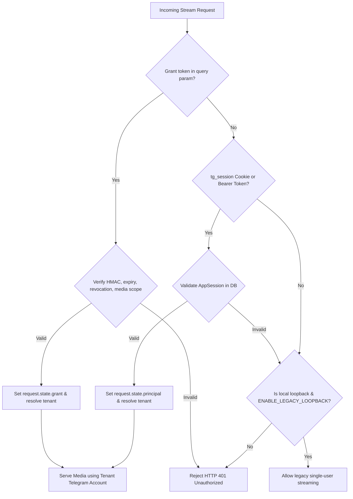

# TG Power Suite v3.0 — Phase 08: Tenant-Aware Media Streaming Gateway & Revocable Playback Grants

**Date:** 2026-11-22  
**Status:** IMPLEMENTED & VERIFIED  
**Components:** `backend/app/services/playback_grants.py`, `backend/app/routes/proxy_streaming.py`, `backend/app/services/stream_cache.py`

---

## 1. Overview & Objectives

In TG Power Suite v2.0.0, streaming routes (`/dl/*` and `/stream/*`) relied on a global Telegram client and global cache files. In v3.0.0, the streaming architecture has been upgraded to guarantee **strict tenant isolation**:

1. **Tenant Authorization Gate:** Remote streaming requests must present either an active v3 session token or a signed, revocable Playback Grant. Unauthenticated remote access is strictly rejected (HTTP 401).
2. **Revocable Playback Grants:** Dedicated capability tokens designed for external players (VLC, Infuse, mobile browsers, cast devices) that cannot attach custom HTTP headers.
3. **Tenant-Scoped Local Cache:** Cache keys, chunk blocks, and merged media files are cryptographically partitioned by `user_id` (`tenant_{user_id}_{chat_id}_{message_id}`).
4. **RFC 9110 & RFC 7233 Compliance:** Full HTTP Range header support, 206 Partial Content, fast seek episodes, and graceful client disconnect teardown.
5. **Zero-Downtime Backward Compatibility:** Retains legacy loopback compatibility (`ENABLE_LEGACY_LOOPBACK=true`) so local single-user tools continue working without configuration changes.

---

## 2. Cryptographic Playback Grants

### Token Specification
External media players (e.g. VLC on Apple TV or Smart TVs) cannot inject HTTP Bearer headers. TG Power Suite v3 introduces URL-safe, time-limited, signed Playback Grants.

```
Token Structure:
[ base64url(payload) ] . [ HMAC-SHA256(secret, base64url(payload)) ]
```

**Payload Schema:**
```json
{
  "gid": "a7c29e1d84f04523bb8e9d3a7e58f01b",
  "uid": "550e8400-e29b-41d4-a716-446655440000",
  "cid": "1234567890",
  "mid": 42,
  "op": "stream",
  "aid": null,
  "exp": 1732305600
}
```

### Security & Integrity Invariants
1. **Media Binding:** The grant token explicitly contains normalized `cid` (Chat ID) and `mid` (Message ID). A grant issued for Movie A **cannot** be used to stream Movie B.
2. **Operation Scoping:** An `op="stream"` grant cannot be used to execute bulk file downloads (`op="download"`), and vice-versa.
3. **Instant Revocation:** A user can revoke individual grants or all active grants at any time via the REST API (`DELETE /api/v3/media/grants/{grant_id}`). Revoked grant IDs are immediately rejected by the gateway.
4. **Expiration:** Grants expire automatically after a configurable TTL (default: 4 hours; max: 7 days).

---

## 3. Streaming Gateway Resolution Sequence

When a request arrives at `/stream/{chat_id}/{message_id}` or `/dl/{chat_id}/{message_id}`:



---

## 4. Tenant Cache Isolation

The local disk cache (`backend/app/services/stream_cache.py`) accelerates seeking and eliminates repetitive MTProto downloads. In v3.0.0:

1. **Block Paths:** Discrete 10MB chunk parts are stored as:
   `BLOCKS_DIR / f"tenant_{user_id}_{chat_id}_{message_id}_part{block_idx:05d}.bin"`
2. **Completed Files:** Fully merged files are stored as:
   `CACHE_DIR / f"tenant_{user_id}_{chat_id}_{message_id}.mp4"`
3. **Cross-Tenant Privacy:** If User A and User B stream the same media file from a shared public channel, each user maintains isolated cache partitions. User B cannot read User A's cached chunks directly from disk.
4. **Cache Gate:** Cache read operations require the requesting tenant's identity. Unauthenticated requests cannot read cached files.

---

## 5. HTTP Range & Player Behavior Preservation

All RFC 9110 streaming invariants from v2.0.0 are fully preserved:
- Single Range requests return `206 Partial Content` with `Content-Range: bytes START-END/TOTAL`.
- Seek episode tracking (`SeekEpisodeManager`) retains candidate 10MB windows during scrubbing.
- Dual-anchor prefetch warms up both the current playback position and the file tail (for MP4 `moov` atom parsing).
- Client disconnects cleanly trigger generator `aclose()`, terminating MTProto fetch tasks and releasing socket semaphores immediately.
