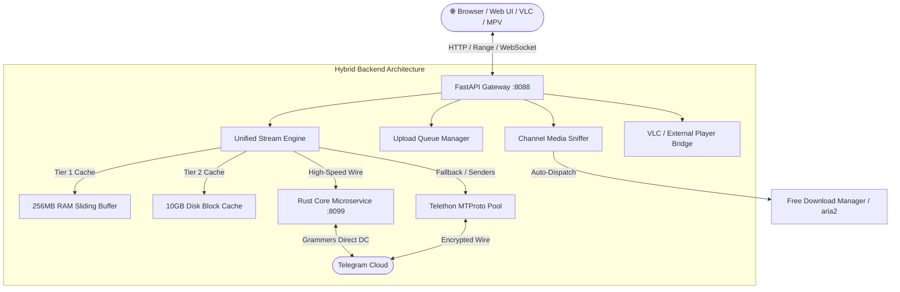

# 🚀 TG Power Suite

<div align="center">


**High-Performance Hybrid Python/Rust MTProto Media Gateway, Video Streaming Suite & Channel Sniffer**

</div>

---

## 📖 Overview

**TG Power Suite** is an enterprise-grade Telegram cloud media streaming gateway, uploader, and channel sniffer. It features a **hybrid Python/Rust architecture**:
- **Python Backend**: FastAPI, Uvicorn, Python-Socket.IO, Telethon MTProto, and SQLite/aiosqlite.
- **Rust Core Acceleration**: Tokio, Axum, and Grammers MTProto daemon (`tg-rust-core`) providing ultra-low latency chunk retrieval and anti-ban pacing.
- **Modern Frontend**: React 19, TypeScript 6, Vite 8, Tailwind CSS 4, Radix UI, and ReUI components.
- **2-Tier Cache Hierarchy**: 256 MB RAM sliding ring-buffer + 10 GB persistent disk block cache with emergency LRU disk guard.



---

## ✨ Key Features

### 🎬 High-Performance Video Streaming & Cinema View
- **Instant Seek Playback**: Episode-aware prefetching and bidirectional seek window caching eliminate player buffering.
- **2-Tier Hybrid Cache**: Retains recently played byte segments in RAM while persisting frequently accessed blocks to NVMe disk.
- **External Player Integration**: 1-click launch to **VLC** and **MPV** with scoped capability grants and M3U8/M3U playlist generation.
- **Subtitle Auto-Discovery**: Automatic extraction, prefetching, and conversion of embedded `.srt` and `.vtt` subtitle tracks.
- **Playback Resume & Auto-Purge**: Auto-tracks playback position across sessions with automatic cleanup at 98% completion.

### 📤 Turbo MTProto Uploader
- **2GB+ Auto-Splitting**: Zero-copy byte range slicing splits massive files into sequence parts (`.part001`, `.part002`) seamlessly.
- **Parallel Workers**: Maximizes upload throughput across Telegram MTProto data centers with rate-governed congestion avoidance.
- **Queue Controls**: Pause, resume, schedule, cancel, and clear batch actions with real-time progress broadcasts.

### 📥 Channel Sniffer & Download Automation
- **Real-Time Monitoring**: Listens for media across 1,400+ channels, groups, and chats.
- **Smart Filtering**: Configurable keyword whitelists, blacklists, and minimum file size filters.
- **1-Click Auto-Dispatch**: Direct integration with Free Download Manager (FDM), aria2, and NeatDM.

### 🔒 Enterprise Security & Hardening
- **Loopback Enforcement**: Local loopback operates seamlessly without auth; remote/LAN/WAN requests strictly require `API_AUTH_TOKEN` (or scoped playback tokens).
- **Default Local Binding**: Server defaults to `127.0.0.1` preventing unintended network exposure.
- **CSRF & CORS Hardened**: Origin and referrer validation on all mutating endpoints; fine-grained CORS origin checks.
- **Session Protection**: Telegram sessions stored in SQLite `.session` files with `0700`/`0600` POSIX permissions.

---

## 🚀 Quick Start

### Option 1: Native Service Runner

```bash
# Clone repository
git clone https://github.com/myselfnandha/TG_TOOL.git
cd TG_TOOL

# Install dependencies and launch
./venv/bin/python backend/run.py start
```

### Option 2: Docker & Docker Compose (Multi-Stage Build)

```bash
docker compose up -d --build
```

The multi-stage build automatically compiles:
1. React 19 Frontend with Node 22 + Vite 8
2. Rust Core Accelerator (`tg-rust-core`) with Rust 1.84
3. Python FastAPI runtime with FFmpeg and media codecs

Access the Web UI at `http://127.0.0.1:8088`.

---

## 📡 Key API Routes

| Route | Method | Description |
| :--- | :---: | :--- |
| `/dl/{chat_id}/{msg_id}/{name}` | `GET` | High-speed byte-range media stream |
| `/stream/{chat_id}/{msg_id}/{name}` | `GET` | Transmuxed streaming endpoint |
| `/dl/{chat_id}/{msg_id}/thumb` | `GET` | Multi-stage cached media thumbnail |
| `/api/media/vlc/play` | `POST` | Launch VLC player with scoped playback grant |
| `/api/media/continue_watching` | `GET` | Fetch resume history and playback positions |
| `/api/media/subtitles/{chat}/{msg}/{idx}.vtt` | `GET` | Extracted WebVTT subtitle stream |
| `/api/upload` | `POST` | Chunked file upload streaming to MTProto |
| `/api/chats` | `GET` | User dialogs, channels, and groups |
| `/api/sniffer/status` | `GET` | Active watched channels and detected managers |
| `/api/system/health` | `GET` | Gateway healthcheck and status |

---

## 🛡️ License

Released under the [MIT License](LICENSE).
