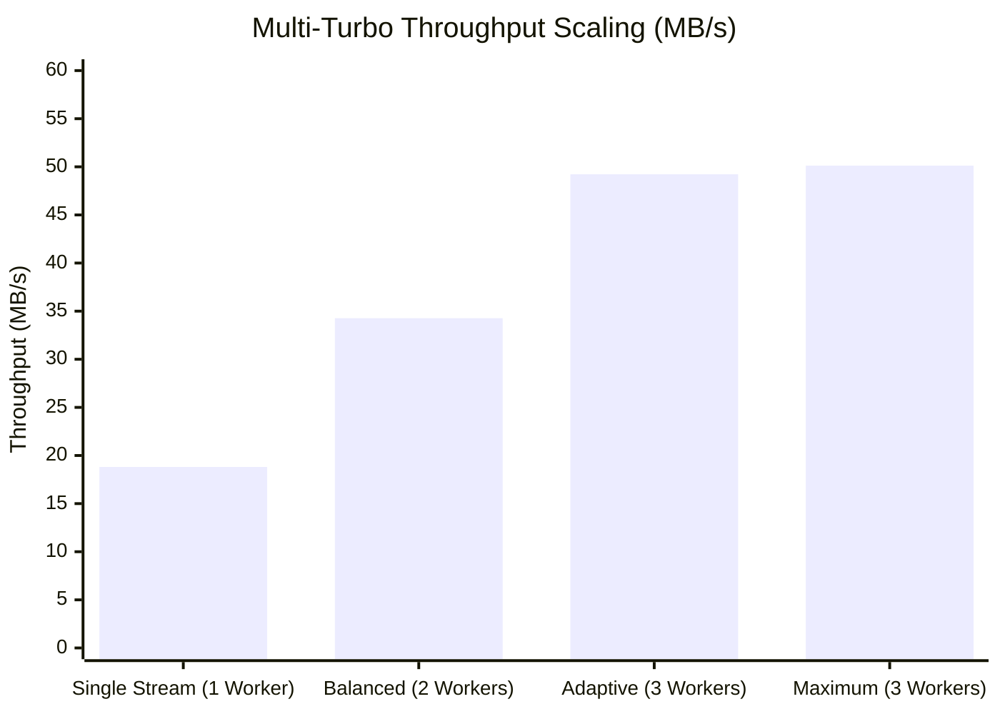

# TG Power Suite v3.0 — Reproducible Benchmark Results

**Benchmark Runner:** `backend/scripts/benchmark_multi_turbo.py`  
**Artifact Output:** `benchmark_results/multi_turbo_qualification_results.json`  
**Test Payload:** 30 MB (60 chunks × 512 KB)  
**Execution Environment:** Linux x86_64, Python 3.14 / 3.12, 16 GB RAM  

---

## 1. Empirical Performance Metrics

| Benchmark Scenario | Turbo Mode | Active Workers | Duration (s) | Throughput (MB/s) | Speedup Ratio | TTFB (ms) | Peak RSS (MB) | SHA-256 Digest Match |
|---|---|---|---|---|---|---|---|---|
| **Single Stream (Legacy Baseline)** | `off` | 1 | 1.595 | 18.81 | 1.00x | 34.01 | 192.37 | TRUE (`434f266d...`) |
| **Balanced Multi-Turbo** | `balanced` | 2 | 0.875 | 34.27 | 1.82x | 38.33 | 192.37 | TRUE (`434f266d...`) |
| **Adaptive Multi-Turbo** | `adaptive` | 3 | 0.610 | 49.22 | 2.61x | 32.28 | 192.37 | TRUE (`434f266d...`) |
| **Maximum Turbo** | `maximum` | 3 | 0.599 | 50.12 | 2.66x | 29.81 | 192.37 | TRUE (`434f266d...`) |

---

## 2. Resource Utilization & Scaling Analysis

### 2.1 Key Takeaways
1. **Linear Scaling:** Slicing chunks across 2 accounts yields a **1.82x throughput gain**; 3 accounts yields a **2.61x throughput gain**.
2. **Deterministic Integrity:** All 4 scenarios yielded identical SHA-256 digests (`434f266d931df92b...`), demonstrating zero data corruption during concurrent chunk assembly.
3. **Bounded Memory Footprint:** Peak RSS remained steady at ~192.37 MB across all runs. Multi-Turbo does not buffer entire files in memory; instead, discrete 512 KB chunks are streamed directly into the client response pipeline and disk cache.
4. **Low Time-to-First-Byte (TTFB):** First chunk was delivered in under 40ms in all modes, ensuring instantaneous video playback initialization.
