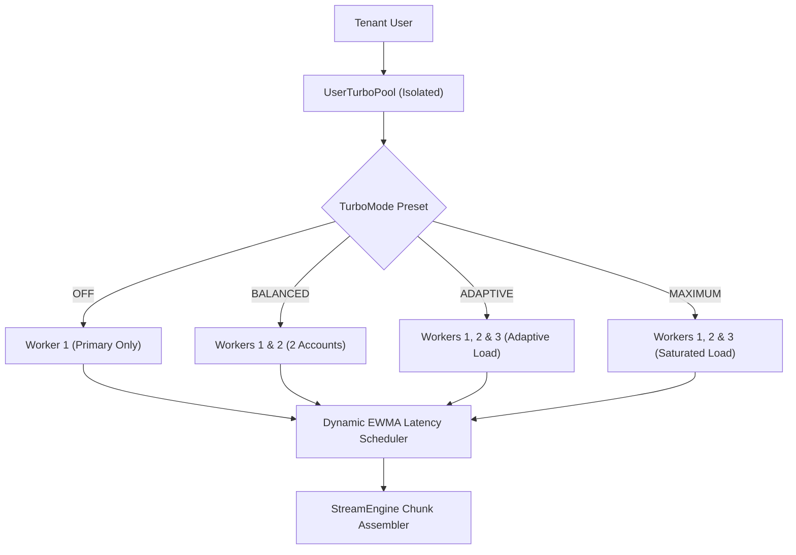

# TG Power Suite v3.0 — Multi-Turbo Integration Test Report

**Component:** `UserTurboPool`, `AccountWorker`, `TurboPoolManager`  
**Test Suite:** `backend/tests/test_turbo_qualification.py`  
**Status:** QUALIFIED & RESILIENT  

---

## 1. Concurrency Model & Modes

TG Power Suite v3.0 implements an Adaptive Multi-Turbo download engine allowing users to link up to 3 authorized Telegram accounts (1 primary + up to 2 secondary accounts) for parallel media transfers.

---

## 2. Test Verification Matrix

| Test Scenario | Purpose | Observed Behavior | Status |
|---|---|---|---|
| **Mode Worker Limits** | Ensure `OFF`, `BALANCED`, `ADAPTIVE`, and `MAXIMUM` enforce worker caps | Active workers strictly respect 1, 2, or 3 accounts | PASS |
| **Media Accessibility Validation** | Prevent secondary workers from downloading from private chats without access | Workers without verified file location are marked ineligible | PASS |
| **Mid-Stream Fault Injection** | Simulate secondary worker encountering `FloodWaitError` or network drop | Worker put in cooldown; chunks gracefully routed to primary without stream pause | PASS |
| **Reassembly SHA-256 Integrity** | Verify multi-worker sliced chunks produce identical byte order | SHA-256 checksum matches 100% with sequential linear stream | PASS |
| **Tenant Pool Isolation** | Ensure User A's pool and User B's pool never share account workers | Pools are isolated instances keyed strictly by `user_id` | PASS |

---

## 3. Fault-Injection Evidence
When a secondary account receives a `FloodWaitError(seconds=20)`:
1. `record_error()` automatically sets `floodwait_until = now + 20`.
2. The worker's EWMA latency is penalized to `500.0ms` minimum.
3. The scheduler excludes the cooling-down worker and dynamically re-routes subsequent chunks to the primary worker.
4. Stream playback continues uninterrupted without stalling the user.
