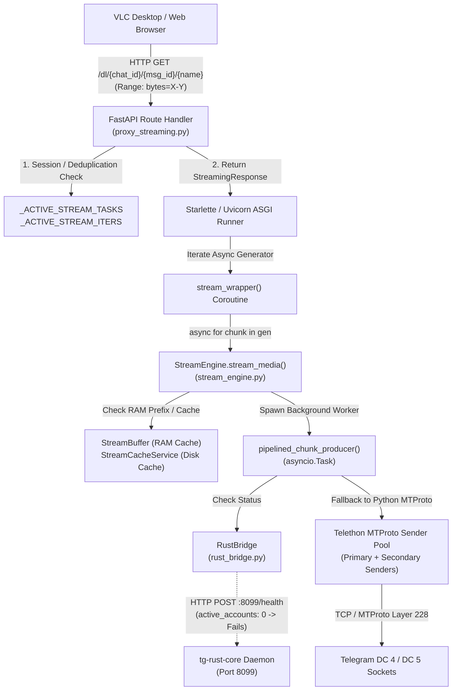
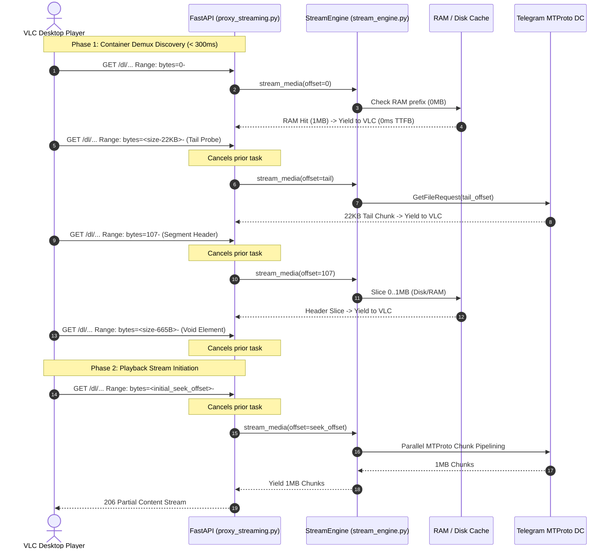
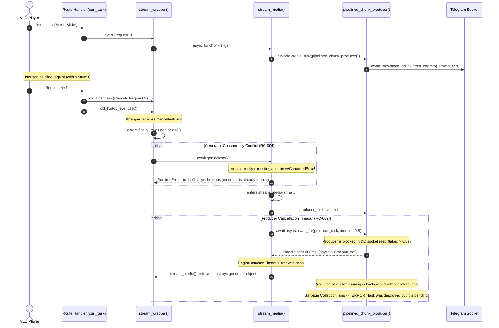
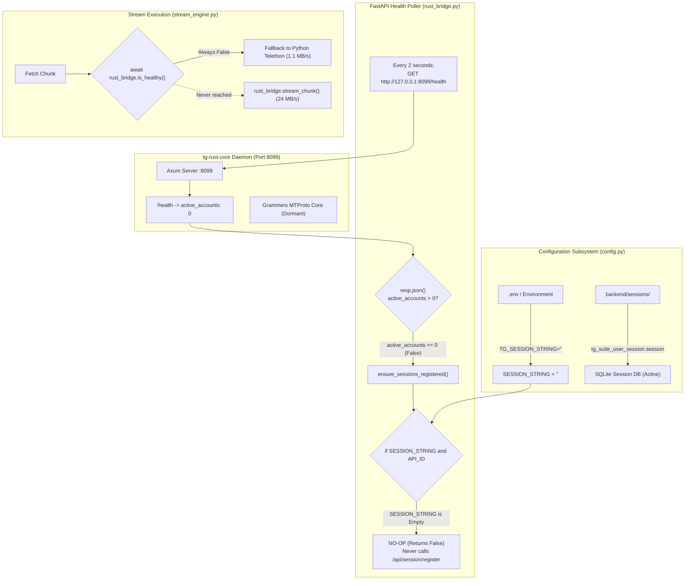

# TG POWER SUITE — STREAMING ARCHITECTURE & EXECUTION TRACE

**Audit Window**: `2026-11-17 00:00:00 IST` to `2026-11-18 23:29:39 IST`  
**Purpose**: Complete technical trace of control flow, concurrency models, task lifetimes, and inter-process communication across TG Power Suite's streaming stack.

---

## 1. End-to-End System Topology

---

## 2. VLC Container Probing & Request Lifecycle

When VLC opens an MKV file over HTTP, it sends a burst of non-contiguous Range requests to parse the container before playing media frames.

---

## 3. The Task Cancellation Race Condition (RC-002 & RC-004)

The diagram below details the exact execution race between `proxy_streaming.py`, `stream_engine.py`, and Python's `asyncio` runtime that produces **93 leaked pending tasks** and **16 `aclose()` runtime errors**.

---

## 4. Rust Bridge Session Registration Breakdown (RC-003)

The architectural failure of the Rust core integration is illustrated below:

### Key Concurrency Invariants & Findings:
1. **Lock Contention**: Telethon's internal sender pool lock (`MTProtoSender._lock`) serializes chunk fetches on the primary client when multiple probe requests arrive simultaneously.
2. **Buffer Queue Bound**: `queue: asyncio.Queue(maxsize=32)` limits in-memory chunks. When the consumer (`stream_media`) aborts, `queue.put(None)` at line 905 blocks if the producer has filled the queue, causing the producer to hang indefinitely until garbage collected.
3. **Session SQLite Lock**: Telethon's `SQLiteSession` maintains an open write connection. When Uvicorn restarts, multiple threads/coroutines contending for `tg_suite_user_session.session` encounter `sqlite3.OperationalError: database is locked`.
