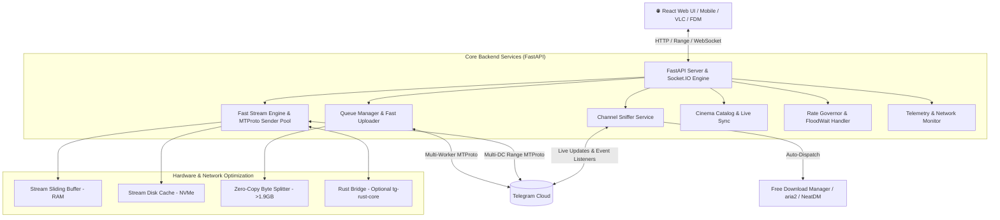

# TG Power Suite — Complete Architectural & Functional Reference Guide

**TG Power Suite** is an enterprise-grade Telegram cloud toolkit combining a high-performance **Turbo MTProto 6-worker upload engine**, an **HTTP Range streaming proxy** (for VLC, MPV, browsers, and external download managers), an **intelligent channel media sniffer**, a **cinema media browser & streaming center**, and a **modern React UI** with live Socket.IO telemetry.

---

## 🏗️ High-Level System Architecture

---

## 📁 1. Entry Points & Server Lifecycle

### [backend/run.py](file:///home/nandha/Desktop/TG_TOOL/backend/run.py)
*Primary server launcher, daemon runner, PID manager, and CLI management tool.*

| Function / Class | What It Does | For What Purpose |
| :--- | :--- | :--- |
| [`EndpointFilter`](file:///home/nandha/Desktop/TG_TOOL/backend/run.py#L36-L51) | Intercepts Uvicorn HTTP access log records and filters out silent polling routes (`/api/governor/status`, `/api/auth/status`, `/api/system/network`, `/socket.io/`). | Prevents log clutter and disk I/O inflation from high-frequency frontend health and telemetry polling. |
| [`setup_file_logging()`](file:///home/nandha/Desktop/TG_TOOL/backend/run.py#L53-L78) | Configures root logging with a 10MB rotating file handler (`tg_power_suite.log`, 3 backups) and console stream handler. | Ensures persistent, rotating log storage for troubleshooting without filling the server drive. |
| [`get_running_pid()`](file:///home/nandha/Desktop/TG_TOOL/backend/run.py#L79-L110) | Inspects `tg_power_suite.pid` or checks active `systemctl --user` units to see if the server process is currently running. | Enables process discovery and cross-session management for CLI commands (`status`, `stop`, `restart`). |
| [`acquire_pid_lock()`](file:///home/nandha/Desktop/TG_TOOL/backend/run.py#L112-L121) | Writes the current process PID to `backend/data/tg_power_suite.pid` if no other instance is running. | Enforces strict single-instance execution to avoid port collisions and database locking issues. |
| [`release_pid_lock()`](file:///home/nandha/Desktop/TG_TOOL/backend/run.py#L122-L129) | Unlinks the PID lockfile if it matches the current process PID upon clean shutdown. | Cleans up runtime state so future launches are not falsely reported as duplicate instances. |
| [`cli_status()`](file:///home/nandha/Desktop/TG_TOOL/backend/run.py#L130-L144) | Checks PID file and systemd status; prints server status, active PID, dashboard URL, and log path. | Provides quick command-line diagnostics (`python run.py status`). |
| [`cli_stop()`](file:///home/nandha/Desktop/TG_TOOL/backend/run.py#L145-L188) | Sends `SIGTERM` followed by `SIGKILL` to running backend and Rust core processes; stops systemd units if active. | Gracefully halts all server workers and daemons from the command line (`python run.py stop`). |
| [`cli_restart()`](file:///home/nandha/Desktop/TG_TOOL/backend/run.py#L189-L201) | Invokes `cli_stop()` then re-launches the server either detached in background or in foreground. | Allows quick configuration reloads or daemon cycling (`python run.py restart`). |
| [`cli_logs()`](file:///home/nandha/Desktop/TG_TOOL/backend/run.py#L202-L224) | Tails the persistent log file or reads from systemd journal with optional live follow (`-f`). | Provides terminal-based log inspection without manual file navigation (`python run.py logs -f`). |
| [`run_server()`](file:///home/nandha/Desktop/TG_TOOL/backend/run.py#L225-L258) | Acquires PID lock, configures logging, optionally starts system tray icon, and runs Uvicorn ASGI server on `HOST:PORT`. | Serves as the main synchronous execution harness hosting `app.main:socket_app`. |
| [`main()`](file:///home/nandha/Desktop/TG_TOOL/backend/run.py#L259-L312) | Parses CLI arguments (`start`, `stop`, `restart`, `status`, `logs`, `--tray`, `--daemon`) and routes execution. | Standard CLI entry point for operating the suite across environments. |

---

### [backend/setup_auth.py](file:///home/nandha/Desktop/TG_TOOL/backend/setup_auth.py)
*Interactive CLI Telegram authentication wizard.*

| Function / Class | What It Does | For What Purpose |
| :--- | :--- | :--- |
| [`main()`](file:///home/nandha/Desktop/TG_TOOL/backend/setup_auth.py#L36-L198) | Prompts user for `API_ID`, `API_HASH`, and phone number, requests login code via Telethon, prompts for OTP and 2FA password, and generates `backend/sessions/tg_uploader.session`. | Sets up Telegram session file without requiring the web UI to be running. |

---

### [backend/app/main.py](file:///home/nandha/Desktop/TG_TOOL/backend/app/main.py)
*FastAPI application core, lifespan context, custom ASGI middlewares, route mounting, and static asset serving.*

| Function / Class | What It Does | For What Purpose |
| :--- | :--- | :--- |
| [`SensitiveDataFilter`](file:///home/nandha/Desktop/TG_TOOL/backend/app/main.py#L51-L78) | Atomic regex logging filter scrubbing authentication tokens, query parameters (`?token=`), Bearer tokens, and API keys. | Prevents sensitive credentials and playback tokens from ever leaking into console output, disk logs, or error traces. |
| [`EndpointFilter`](file:///home/nandha/Desktop/TG_TOOL/backend/app/main.py#L79-L94) | Filters out high-frequency polling paths from Uvicorn access logger. | Reduces log spam. |
| [`cleanup_stale_temp_files()`](file:///home/nandha/Desktop/TG_TOOL/backend/app/main.py#L109-L120) | Scans `backend/temp_uploads` and deletes unfinished files older than 2 hours. | Prevents disk space exhaustion from interrupted or abandoned uploads. |
| [`_telemetry_broadcast_loop()`](file:///home/nandha/Desktop/TG_TOOL/backend/app/main.py#L122-L133) | Asynchronous background loop broadcasting CPU, RAM, active bandwidth, and uptime via Socket.IO every 2 seconds. | Powers real-time sparkline graphs and resource meters in the web header. |
| [`_periodic_maintenance_loop()`](file:///home/nandha/Desktop/TG_TOOL/backend/app/main.py#L134-L146) | Periodic hourly task running stale file cleanup and stream cache eviction. | Keeps storage bounded during long continuous server operation. |
| [`lifespan(app)`](file:///home/nandha/Desktop/TG_TOOL/backend/app/main.py#L147-L260) | Async context manager initializing SQLite DBs, wiring callbacks to Socket.IO, starting upload/download workers, initializing Telegram clients, starting Network Monitor and Rust bridge daemon, and handling clean shutdown. | Coordinates whole-application startup sequence and graceful resource release. |
| [`SmartStaticCacheASGIMiddleware`](file:///home/nandha/Desktop/TG_TOOL/backend/app/main.py#L272-L311) | ASGI middleware setting 1-year immutable caching on content-hashed assets (`/assets/*`, `.woff2`) and strict zero-cache (`no-cache, no-store`) on dynamic entry points (`index.html`, `sw.js`). | Guarantees instant frontend reloads upon update while maximizing client asset caching performance. |
| [`ClientDisconnectSuppressorMiddleware`](file:///home/nandha/Desktop/TG_TOOL/backend/app/main.py#L312-L335) | Suppresses ASGI/Uvicorn `ClientDisconnect`, `BrokenPipeError`, and `ConnectionResetError` exceptions. | Prevents noisy stack traces when media players (VLC, MPV) suddenly close connections during video seeking. |
| [`MediaExcludingGZipMiddleware`](file:///home/nandha/Desktop/TG_TOOL/backend/app/main.py#L336-L357) | Applies GZip compression to JSON APIs and web assets while strictly bypassing streaming media routes (`/dl/`, `/stream/`, `.mp4`, `.mkv`). | Ensures 100% byte-accurate HTTP Range requests without breaking video container demuxers. |
| [`GlobalAuthEnforcementMiddleware`](file:///home/nandha/Desktop/TG_TOOL/backend/app/main.py#L358-L431) | Zero-trust authentication middleware allowing local loopback without tokens (if configured) while strictly blocking external/remote requests unless valid API token or signed playback token is provided. | Protects private data and Telegram MTProto access from unauthorized network visitors. |
| Static Routes: `serve_index`, `serve_manifest`, `serve_favicon`, `serve_icons`, `serve_sw` | Serves compiled React web assets, PWA manifest, and service worker. | Delivers frontend single-page application directly from the FastAPI server. |

---

## ⚙️ 2. Core Configuration, Auth & State Models

### [backend/app/config.py](file:///home/nandha/Desktop/TG_TOOL/backend/app/config.py)
*Central application settings, environment variables, directory paths, and thresholds.*

| Function / Constant | What It Does | For What Purpose |
| :--- | :--- | :--- |
| Directory Constants | Defines `BACKEND_DIR`, `DATA_DIR`, `TEMP_UPLOAD_DIR`, `SESSION_DIR`, `DOWNLOADS_DIR`, `FRONTEND_DIR`. | Standardizes file locations across local storage. |
| Storage Alignment | Sets `tempfile.tempdir = str(TEMP_UPLOAD_DIR)`. | Redirects system temp writes from RAM `/tmp` to local NVMe storage, preventing out-of-memory crashes on large files. |
| MTProto Limits | `MAX_TELEGRAM_FILE_SIZE` (2GB), `SPLIT_THRESHOLD` (1.9GB), `STREAM_THRESHOLD` (500MB), `CHUNK_READ_SIZE` (4MB). | Defines thresholds for when files must be split into sequence parts. |
| [`set_multi_account_turbo(enabled)`](file:///home/nandha/Desktop/TG_TOOL/backend/app/config.py#L65-L89) | Toggles dual-account MTProto pooling mode and persists preference to `.env`. | Doubles streaming throughput across two Telegram accounts. |
| [`update_session_string_in_env(s)`](file:///home/nandha/Desktop/TG_TOOL/backend/app/config.py#L93-L115) | Writes primary Telegram session string into `.env`. | Persists authenticated session without manual file editing. |
| [`update_secondary_session_string_in_env(s)`](file:///home/nandha/Desktop/TG_TOOL/backend/app/config.py#L117-L140) | Writes secondary Telegram session string into `.env`. | Persists secondary turbo account session. |
| [`get_env_dict()`](file:///home/nandha/Desktop/TG_TOOL/backend/app/config.py#L178-L196) | Reads `.env` into a clean dictionary ignoring comments and blank lines. | Supplies settings view with current system configuration. |
| [`save_env_dict(updates)`](file:///home/nandha/Desktop/TG_TOOL/backend/app/config.py#L197-L229) | Updates specific keys in `.env` preserving formatting and comments, then reloads environment. | Allows the Web UI settings tab to change system parameters on the fly. |

---

### [backend/app/auth.py](file:///home/nandha/Desktop/TG_TOOL/backend/app/auth.py)
*Security enforcement, loopback detection, capability token validation, and FastAPI dependencies.*

| Function / Class | What It Does | For What Purpose |
| :--- | :--- | :--- |
| [`is_loopback_request(req)`](file:///home/nandha/Desktop/TG_TOOL/backend/app/auth.py#L12-L24) | Checks if client IP is `127.0.0.1`, `::1`, or `localhost` and confirms no reverse proxy headers (`cf-connecting-ip`, `x-forwarded-for`, `x-real-ip`) exist. | Accurately identifies genuine local requests versus remote tunneled requests. |
| [`is_authenticated(req)`](file:///home/nandha/Desktop/TG_TOOL/backend/app/auth.py#L26-L86) | Validates Bearer token, `X-API-Key` header, query parameter `?token=`, or signed media-scoped capability `playback_token`. | Verifies whether a request is authorized to access media or API endpoints. |
| [`verify_auth(req)`](file:///home/nandha/Desktop/TG_TOOL/backend/app/auth.py#L88-L113) | FastAPI route dependency enforcing authentication on sensitive mutating endpoints. | Rejects unauthorized requests with 401 Unauthorized or 403 Forbidden. |

---

### [backend/app/models.py](file:///home/nandha/Desktop/TG_TOOL/backend/app/models.py)
*Pydantic data models for typed REST endpoints and frontend contracts.*

| Class | What It Does | For What Purpose |
| :--- | :--- | :--- |
| [`SendMode`](file:///home/nandha/Desktop/TG_TOOL/backend/app/models.py#L6-L10) | Enum defining upload mode: `AUTO`, `DOCUMENT`, `MEDIA`. | Controls whether files are sent as uncompressed documents or streaming media. |
| [`UploadStatus`](file:///home/nandha/Desktop/TG_TOOL/backend/app/models.py#L11-L21) | Enum defining task lifecycle states (`QUEUED`, `SPLITTING`, `UPLOADING`, `PAUSED`, `COMPLETED`, `CANCELLED`, `FAILED`). | Normalizes task states across database, queue manager, and UI. |
| [`ChatItem`](file:///home/nandha/Desktop/TG_TOOL/backend/app/models.py#L24-L33) | Schema representing a Telegram dialog (id, name, username, type, unread count, pinned status, photo URL). | Supplies chat picker and dialog list with structured metadata. |
| [`UploadHistoryItem`](file:///home/nandha/Desktop/TG_TOOL/backend/app/models.py#L34-L50) | Schema representing an audit record of a past transfer. | Serializes transfer history records for UI and CSV export. |
| [`UploadTaskState`](file:///home/nandha/Desktop/TG_TOOL/backend/app/models.py#L51-L64) | Schema representing an active upload task with progress, speed, ETA, and parts. | Powers live upload progress cards in the UI. |
| [`AuthStatus`](file:///home/nandha/Desktop/TG_TOOL/backend/app/models.py#L65-L72) | Schema representing user authentication state and Telegram profile information. | Informs UI whether login is required and displays user profile. |

---

### [backend/app/socket_handlers.py](file:///home/nandha/Desktop/TG_TOOL/backend/app/socket_handlers.py)
*Socket.IO real-time event server, WebSocket authentication, and live broadcast functions.*

| Function / Event | What It Does | For What Purpose |
| :--- | :--- | :--- |
| [`is_loopback_socket_environ(env)`](file:///home/nandha/Desktop/TG_TOOL/backend/app/socket_handlers.py#L19-L26) | Inspects WS environment dictionary for loopback IP and absence of proxy headers. | Restricts unauthenticated WebSocket handshakes to local clients. |
| [`verify_socket_auth(env, auth)`](file:///home/nandha/Desktop/TG_TOOL/backend/app/socket_handlers.py#L28-L65) | Validates WebSocket authentication credentials from auth payload, query string, or headers. | Secures real-time event streams from unauthorized WebSocket connections. |
| [`connect(sid, environ, auth)`](file:///home/nandha/Desktop/TG_TOOL/backend/app/socket_handlers.py#L68-L88) | Handles new client connection; sends initial snapshot of upload queue, download queue, and sniffer feed. | Synchronizes new client UI state immediately upon opening the page. |
| [`disconnect(sid)`](file:///home/nandha/Desktop/TG_TOOL/backend/app/socket_handlers.py#L90-L92) | Cleans up client socket state upon disconnect. | Resource cleanup. |
| Socket actions: `upload_pause`, `upload_resume`, `upload_cancel`, `download_pause`, `download_resume`, `download_cancel`, `queue_get` | Dispatches task control commands directly to `queue_manager` or `download_manager`. | Allows ultra-low-latency task control from the web interface without HTTP roundtrips. |
| [`broadcast_task_progress(item)`](file:///home/nandha/Desktop/TG_TOOL/backend/app/socket_handlers.py#L160-L164) | Emits `upload:progress` event with updated progress, speed, ETA, and state to all clients. | Drives real-time progress bars in the browser. |
| [`broadcast_download_progress(data)`](file:///home/nandha/Desktop/TG_TOOL/backend/app/socket_handlers.py#L166-L174) | Emits `download:progress` event for active HTTP URL downloads. | Updates active download progress in UI. |
| [`broadcast_sniffer_event(name, data)`](file:///home/nandha/Desktop/TG_TOOL/backend/app/socket_handlers.py#L176-L183) | Emits `sniffer:<name>` events for incoming intercepted media files or status updates. | Adds new media cards to the sniffer view in real time. |

---

## ⚡ 3. MTProto Engine & Client Management

### [backend/app/telegram_client.py](file:///home/nandha/Desktop/TG_TOOL/backend/app/telegram_client.py)
*Telethon MTProto client lifecycle, Layer 228 patch, QR login engine, multi-account pool, and sender pooling.*

| Function / Class | What It Does | For What Purpose |
| :--- | :--- | :--- |
| [`UserLayer228`](file:///home/nandha/Desktop/TG_TOOL/backend/app/telegram_client.py#L39-L100) | Custom Telethon TL constructor subclass updating MTProto deserialization for Telegram Layer 228 changes. | Prevents crash bugs when receiving newer Telegram user objects with extra flags. |
| [`_is_permanent_revocation(e)`](file:///home/nandha/Desktop/TG_TOOL/backend/app/telegram_client.py#L137-L140) | Detects whether an authentication exception (`AuthKeyUnregisteredError`, `UserDeactivatedError`) represents an unrecoverable revocation. | Signals the system to clear dead session tokens without looping indefinitely. |
| [`generate_qr_data_url(token)`](file:///home/nandha/Desktop/TG_TOOL/backend/app/telegram_client.py#L141-L162) | Takes raw Telegram login token bytes, converts to `tg://login?token=...`, and generates a PNG Data URL via `qrcode`. | Enables passwordless Telegram mobile app login by displaying a scannable QR code. |
| Custom MTProto Hooks: `_safe_conn_recv_loop`, `_safe_handle_gzip_packed`, `_safe_conn_disconnect`, `_safe_conn_connect`, `_safe_sender_connect`, `_patched_iter_download` | Low-level monkey patches for Telethon transport handling gzip unpacking and socket disconnections. | Hardens MTProto connections against silent socket drops and demuxer desync during gigabyte-scale transfers. |
| [`TelegramClientManager`](file:///home/nandha/Desktop/TG_TOOL/backend/app/telegram_client.py#L343-L1134) | Singleton orchestrating both Primary and Secondary Telegram client instances: | Centralizes all Telegram connection logic and account credentials. |
| • `get_client()` | Connects and returns the primary authenticated Telethon client instance. | Provides active MTProto connection to services. |
| • `reconnect_primary()` | Safely resets and reconnects the primary client if the transport drops. | Automated connection recovery. |
| • `ensure_connected()` | Verifies that client connection is live before making RPC calls. | Prevents sending commands to closed sockets. |
| • `is_authorized()` / `is_secondary_authorized()` | Checks if valid authorized sessions exist. | Drives authentication status indicators. |
| • `get_me_info()` / `get_secondary_me_info()` | Fetches user profile, username, phone, and user ID. | Displays active user info in settings. |
| • `send_login_code(phone)` | Sends Telegram login OTP to specified phone number. | Powers SMS/Telegram code login flow. |
| • `sign_in_with_code(code)` | Submits received login code to complete authentication. | Completes phone login. |
| • `sign_in_with_2fa(password)` | Submits two-factor password if account has 2FA enabled. | Completes 2FA login. |
| • `start_qr_login()` / `start_secondary_qr_login()` | Initiates QR login challenge and spawns background polling task. | Powers QR code login feature. |
| • `get_qr_status()` / `get_secondary_qr_status()` | Returns current QR code status (active token image, expired, completed). | UI polling endpoint for QR login progress. |
| • `logout()` / `logout_secondary()` | Logs out session from Telegram MTProto and deletes session files. | Clean user sign-out. |
| • `get_active_streaming_clients()` | Returns list of available authorized clients (primary + secondary if turbo enabled). | Distributes streaming load across multiple accounts. |
| [`MTProtoSenderPool`](file:///home/nandha/Desktop/TG_TOOL/backend/app/telegram_client.py#L1189-L1625) | Dedicated connection pool managing up to 6 raw MTProto senders per Telegram Data Center (DC): | Eliminates head-of-line blocking and unlocks maximum parallel download throughput. |
| • `acquire(dc_id)` | Borrows an authenticated, connected MTProto sender for a specific DC. | Fetches chunks concurrently. |
| • `release(sender, dc_id)` | Returns sender back to the idle pool or cleans up closed sockets. | Reuses established TCP/MTProto handshakes. |
| • `_keepalive_loop()` | Periodically pings idle senders with `PingRequest` every 30 seconds. | Prevents Telegram DC edge servers from dropping idle connections. |
| • `purge_dc(dc_id)` / `disconnect_all()` | Disconnects and destroys cached senders on shutdown or DC error. | Resource cleanup. |

---

## 🛠️ 4. Backend Services Deep-Dive

### [backend/app/services/cinema_catalog.py](file:///home/nandha/Desktop/TG_TOOL/backend/app/services/cinema_catalog.py)
*Video message indexing, catalog caching, and dialog video browsing engine.*

| Function / Method | What It Does | For What Purpose |
| :--- | :--- | :--- |
| [`parse_video_message(msg)`](file:///home/nandha/Desktop/TG_TOOL/backend/app/services/cinema_catalog.py#L50-L163) | Analyzes a Telethon Message object to detect video attachments (Document with video MIME, Video attribute, or Video note); extracts duration, width, height, filename, file size, thumbnail, and post date. | Normalizes Telegram message metadata into a clean, unified cinema video object. |
| [`process_incoming_video_message(event)`](file:///home/nandha/Desktop/TG_TOOL/backend/app/services/cinema_catalog.py#L164-L223) | Parses incoming message event in real time and inserts video item into the SQLite cinema catalog cache. | Keeps the Cinema view updated with newly posted videos without requiring a full channel re-scan. |
| [`get_streamable_message(client, chat_id, msg_id)`](file:///home/nandha/Desktop/TG_TOOL/backend/app/services/cinema_catalog.py#L224-L418) | Resolves chat entity, handles channel ID prefixes (`-100...`), queries message by ID, resolves forwarded origins if needed, and returns the exact message holding the media document. | Guarantees that the streaming proxy can locate the media document even across forwarded channels. |
| [`remove_deleted_video(chat_id, msg_id)`](file:///home/nandha/Desktop/TG_TOOL/backend/app/services/cinema_catalog.py#L419-L471) | Deletes specified video record from SQLite catalog cache. | Prevents broken video links when messages are deleted in Telegram. |
| [`get_videos(chat_id, offset_id, limit)`](file:///home/nandha/Desktop/TG_TOOL/backend/app/services/cinema_catalog.py#L472-L536) | Queries cached videos from SQLite database; if empty or exhausted, calls `_fetch_and_cache` to backfill from MTProto. | Provides sub-millisecond paginated catalog loading for the Cinema tab. |
| [`_fetch_and_cache(client, chat_id, offset_id, limit)`](file:///home/nandha/Desktop/TG_TOOL/backend/app/services/cinema_catalog.py#L537-L614) | Uses `client.iter_messages` with video filter to fetch historical media messages, parses each, and commits them to SQLite. | Harvests video libraries from Telegram channels into local index. |

---

### [backend/app/services/fast_stream_engine.py](file:///home/nandha/Desktop/TG_TOOL/backend/app/services/fast_stream_engine.py)
*High-speed parallel MTProto streaming engine for media playback (HTTP 206 Partial Content).*

| Function / Method | What It Does | For What Purpose |
| :--- | :--- | :--- |
| [`MediaStreamSession`](file:///home/nandha/Desktop/TG_TOOL/backend/app/services/fast_stream_engine.py#L26-L89) | Tracks an active media streaming session, its cached byte ranges, downloaded slices, and last-accessed timestamp. | Coordinates multi-threaded requests targeting the same media file. |
| [`FastStreamEngine`](file:///home/nandha/Desktop/TG_TOOL/backend/app/services/fast_stream_engine.py#L90-L600) | Core parallel streaming engine coordinating memory buffers, disk cache, and MTProto sender pools: | Achieves full-bandwidth streaming for smooth 4K/1080p seeking. |
| • `get_or_create_session(...)` | Returns or constructs session tracker for a given `chat_id:message_id`. | Manages streaming lifecycle per file. |
| • `_acquire_sender(dc_id)` / `_release_sender(...)` | Borrows connected sender from `MTProtoSenderPool`. | Manages DC socket reuse. |
| • `_fetch_single_chunk(...)` | Dispatches single raw MTProto `upload.getFile` request for a 512KB/1MB block with retry and backoff logic. | Core atomic chunk retrieval function. |
| • `stream_parallel_mtproto(...)` | Spawns multiple parallel workers fetching non-contiguous chunks concurrently across the sender pool. | Multiplies download throughput compared to sequential downloads. |
| • `prebuffer_media(...)` | Pre-fetches the first 4MB of the media file and the last 2MB (tail containing moov atom / MKV SeekHead). | Ensures instantaneous playback start in VLC, MPV, and web player without buffering delay. |
| • `ensure_slice(...)` | Checks sliding memory buffer and disk cache; fetches missing blocks from Telegram if not cached. | Satisfies HTTP Range requests from cache whenever possible. |
| • `stream_byte_range(...)` | High-level async generator yielding exact byte slices to FastAPI `StreamingResponse`. | Powers HTTP 206 partial content streaming endpoints. |

---

### [backend/app/services/fast_uploader.py](file:///home/nandha/Desktop/TG_TOOL/backend/app/services/fast_uploader.py)
*Turbo parallel MTProto chunk uploader.*

| Function | What It Does | For What Purpose |
| :--- | :--- | :--- |
| [`get_optimal_chunk_config(file_size)`](file:///home/nandha/Desktop/TG_TOOL/backend/app/services/fast_uploader.py#L22-L36) | Computes optimal chunk size (512KB) and concurrency level (up to 6 parallel workers) based on file size. | Optimizes MTProto pipeline depth for maximum transfer rate. |
| [`upload_file_turbo(client, file_path, ...)`](file:///home/nandha/Desktop/TG_TOOL/backend/app/services/fast_uploader.py#L37-L200) | Reads file parts from disk, assigns unique `file_id`, distributes chunk upload calls (`upload.saveBigFilePart`) across concurrent async workers, throttles via `RateGovernor`, and handles pause/cancel events. | Delivers 30-80 MB/s upload speeds to Telegram cloud. |

---

### [backend/app/services/queue_manager.py](file:///home/nandha/Desktop/TG_TOOL/backend/app/services/queue_manager.py)
*Upload queue orchestration, priority worker pool, task scheduling, and night mode.*

| Function / Class | What It Does | For What Purpose |
| :--- | :--- | :--- |
| [`NightModeManager`](file:///home/nandha/Desktop/TG_TOOL/backend/app/services/queue_manager.py#L19-L54) | Evaluates whether current system time falls within the configured Night Mode window (e.g. 00:00 to 07:00). | Restricts heavy upload bandwidth consumption to off-peak hours. |
| [`UploadItem`](file:///home/nandha/Desktop/TG_TOOL/backend/app/services/queue_manager.py#L55-L102) | Data class holding complete runtime state of an upload task (file path, chat ID, speed, ETA, progress, cancel/pause events). | Represents an active or queued job inside the engine. |
| [`QueueManager`](file:///home/nandha/Desktop/TG_TOOL/backend/app/services/queue_manager.py#L103-L450) | Central upload management singleton: | Coordinates all file uploading across the suite. |
| • `add_task(...)` | Enqueues a new file for upload; checks if file exceeds 1.9GB and triggers auto-splitting if needed. | Accepts upload jobs from Web UI, folder watcher, or download manager. |
| • `schedule_task(task_id, time)` | Sets scheduled execution timestamp for a queued task. | Supports delayed/scheduled uploading. |
| • `pause_task(...)` / `resume_task(...)` | Pauses or resumes an individual upload task via thread events. | Granular transfer control. |
| • `cancel_task(...)` | Halts upload task immediately and cleans up temporary split files. | Aborts unwanted uploads. |
| • `pause_all_tasks()` / `resume_all_tasks()` | Batch-pauses or batch-resumes all pending tasks. | Toolbar bulk actions. |
| • `clear_completed_tasks()` | Purges finished and cancelled tasks from memory queue. | Keeps task list clean. |
| • `_worker_loop()` | Continuous worker loop picking next eligible task and delegating to `_process_upload`. | Concurrency control (configurable worker count). |
| • `_process_upload(item)` | Manages file preparation, thumbnail extraction, splitting if needed, `fast_uploader` execution, and database history recording. | End-to-end task execution pipeline. |

---

### [backend/app/services/sniffer_service.py](file:///home/nandha/Desktop/TG_TOOL/backend/app/services/sniffer_service.py)
*Real-time channel media monitoring, keyword/extension filtering, multi-quality deduplication, and download auto-dispatch.*

| Function / Method | What It Does | For What Purpose |
| :--- | :--- | :--- |
| [`attach_to_client(client)`](file:///home/nandha/Desktop/TG_TOOL/backend/app/services/sniffer_service.py#L679-L720) | Hooks Telethon `events.NewMessage` and `events.MessageEdited` on the primary client. | Listens for all incoming messages across user dialogs in real time. |
| [`add_channel(target)`](file:///home/nandha/Desktop/TG_TOOL/backend/app/services/sniffer_service.py#L435-L444) | Adds channel ID or username to watched list and persists to `.env`. | Expands sniffer watchlist. |
| [`remove_channel(target)`](file:///home/nandha/Desktop/TG_TOOL/backend/app/services/sniffer_service.py#L445-L454) | Removes channel from watched list and updates `.env`. | Modifies sniffer watchlist. |
| [`_is_keyword_blocked(text)`](file:///home/nandha/Desktop/TG_TOOL/backend/app/services/sniffer_service.py#L474-L488) | Checks if text matches any blacklist regex (`sample`, `trailer`, `cam`, `telesync`). | Filters out unwanted releases. |
| [`_is_keyword_allowed(text)`](file:///home/nandha/Desktop/TG_TOOL/backend/app/services/sniffer_service.py#L489-L501) | Checks if text matches whitelist rules (if whitelist is configured). | Enforces strict keyword criteria. |
| Quality Grouper: `_quality_score`, `_group_key`, `_flush_quality_group` | Groups releases posted within a time window (`QUALITY_WAIT_SECS`) by title/year, evaluates quality ranking (4K > 1080p > 720p), and selects the highest quality file. | Prevents duplicate downloads when channels post multiple resolutions simultaneously. |
| [`_process_incoming_media(event)`](file:///home/nandha/Desktop/TG_TOOL/backend/app/services/sniffer_service.py#L617-L678) | Inspects incoming media against size thresholds, extension filters, and keywords; generates local streaming URL and dispatches to external download manager via `auto_send`. | Automates end-to-end media interception and downloading. |

---

### [backend/app/services/rate_governor.py](file:///home/nandha/Desktop/TG_TOOL/backend/app/services/rate_governor.py)
*FloodWait protection, adaptive concurrency throttling, and Telegram API tier governance.*

| Function / Method | What It Does | For What Purpose |
| :--- | :--- | :--- |
| [`configure_for_tier(is_premium)`](file:///home/nandha/Desktop/TG_TOOL/backend/app/services/rate_governor.py#L54-L88) | Sets concurrency limits and bandwidth quotas based on Telegram account tier (Premium vs Standard). | Adjusts transfer aggressiveness to match Telegram account permissions. |
| [`report_flood_wait(secs, client_id)`](file:///home/nandha/Desktop/TG_TOOL/backend/app/services/rate_governor.py#L131-L206) | Records FloodWait cooldown duration, pauses affected account, and broadcasts alert event to UI. | Safely handles Telegram rate-limit penalties without crashing workers. |
| [`acquire_chunk_slot()`](file:///home/nandha/Desktop/TG_TOOL/backend/app/services/rate_governor.py#L239-L284) | Token-bucket rate governor acquiring transfer permission before chunks are dispatched over MTProto. | Smooths out network bursts and stays under Telegram API rate caps. |
| [`get_status()`](file:///home/nandha/Desktop/TG_TOOL/backend/app/services/rate_governor.py#L302-L320) | Returns current governor state, remaining cooldown seconds, and active rate limit. | Supplies UI with FloodWait status. |

---

### [backend/app/services/playback_tracker.py](file:///home/nandha/Desktop/TG_TOOL/backend/app/services/playback_tracker.py)
*Video playback position tracking, resume timestamps, and "Continue Watching" database.*

| Function / Method | What It Does | For What Purpose |
| :--- | :--- | :--- |
| [`update_progress(chat_id, msg_id, pos, dur)`](file:///home/nandha/Desktop/TG_TOOL/backend/app/services/playback_tracker.py#L65-L147) | Updates playback timestamp, duration, completion percentage, and last-watched time in SQLite. | Tracks where user paused a video. |
| [`update_byte_progress(...)`](file:///home/nandha/Desktop/TG_TOOL/backend/app/services/playback_tracker.py#L148-L230) | Estimates playback progress based on HTTP Range requested byte offsets when media player does not report time. | Provides fallback resume tracking for players like basic VLC without webhooks. |
| [`get_playback_progress(chat_id, msg_id)`](file:///home/nandha/Desktop/TG_TOOL/backend/app/services/playback_tracker.py#L231-L247) | Queries saved resume timestamp and percentage for a video. | Enables player to resume exactly where playback stopped. |
| [`get_continue_watching(limit)`](file:///home/nandha/Desktop/TG_TOOL/backend/app/services/playback_tracker.py#L248-L274) | Returns sorted list of in-progress videos (between 5% and 92% watched) ordered by recent view time. | Powers the "Continue Watching" carousel in Cinema and navigation drawers. |
| [`remove_progress(chat_id, msg_id)`](file:///home/nandha/Desktop/TG_TOOL/backend/app/services/playback_tracker.py#L275-L295) | Removes item from continue watching when video reaches completion or user dismisses it. | Keeps continue watching list relevant. |

---

### [backend/app/services/stream_buffer.py](file:///home/nandha/Desktop/TG_TOOL/backend/app/services/stream_buffer.py)
*High-performance in-memory sliding window buffer and tail ring buffer.*

| Function / Method | What It Does | For What Purpose |
| :--- | :--- | :--- |
| [`StreamSlidingBuffer`](file:///home/nandha/Desktop/TG_TOOL/backend/app/services/stream_buffer.py#L11-L498) | Manages byte slices in RAM with global budget enforcement: | Eliminates redundant network reads during video seek and replay. |
| • `push(key, offset, data)` | Inserts chunk into sliding buffer for a media file. | Caches recently requested video chunks. |
| • `push_tail(key, total_size, offset, data)` | Dedicated cache for chunks located within the last 4MB of a file. | Preserves video container indexes (moov atom / MKV cues) in RAM. |
| • `get_slice(key, start, length)` | Returns requested byte slice from RAM if completely contained in cached blocks. | Provides zero-latency responses to player seek requests. |
| • `prewarm_media(...)` / `prewarm_tail(...)` | Proactively fetches start and end blocks into buffer. | Guarantees instant video startup. |
| • `_enforce_global_budget()` | Evicts oldest chunks when total RAM consumption exceeds budget (e.g. 512MB). | Protects host system from memory pressure. |

---

### [backend/app/services/stream_cache.py](file:///home/nandha/Desktop/TG_TOOL/backend/app/services/stream_cache.py)
*Two-tier NVMe disk block cache and automatic complete file assembler.*

| Function / Method | What It Does | For What Purpose |
| :--- | :--- | :--- |
| [`StreamCacheManager`](file:///home/nandha/Desktop/TG_TOOL/backend/app/services/stream_cache.py#L21-L260) | Manages persisted streaming blocks on disk (`backend/data/stream_cache/`): | Avoids re-downloading media blocks across multiple player sessions. |
| • `save_block(chat_id, msg_id, idx, data)` | Saves 1MB block to disk file. | Persists downloaded blocks. |
| • `has_block(...)` / `read_block_slice(...)` | Reads block slice directly from disk if available. | Local disk cache hit. |
| • `merge_blocks_if_complete(...)` | Checks if all blocks for a file have been downloaded; if complete, merges blocks into a contiguous `.mp4` or `.mkv` file. | Automatically converts streamed videos into permanent offline files without duplicate downloading. |
| • `evict_if_needed()` | Removes oldest cached files and block fragments when cache size exceeds limit. | Enforces disk quota. |

---

### [backend/app/services/stream_saver.py](file:///home/nandha/Desktop/TG_TOOL/backend/app/services/stream_saver.py)
*Automated media library organizer for completed streams.*

| Function / Method | What It Does | For What Purpose |
| :--- | :--- | :--- |
| [`get_organized_path(filename)`](file:///home/nandha/Desktop/TG_TOOL/backend/app/services/stream_saver.py#L42-L68) | Parses media title, year, season, and episode; constructs organized library paths like `Videos/Telegram_Cinema/Movies/Inception (2010)/Inception.mp4` or `TV Shows/Breaking Bad/Season 01/S01E01.mkv`. | Automatically sorts media into structured Plex/Jellyfin-compatible folders. |
| [`save_completed_stream(src, filename)`](file:///home/nandha/Desktop/TG_TOOL/backend/app/services/stream_saver.py#L83-L125) | Moves 100% completed streamed file into the organized directory and copies associated `.srt` subtitles alongside it. | Archives watched videos into the permanent library. |

---

### [backend/app/services/subtitle_service.py](file:///home/nandha/Desktop/TG_TOOL/backend/app/services/subtitle_service.py)
*Subtitle extraction, format conversion (SRT to VTT), and title parsing.*

| Function / Method | What It Does | For What Purpose |
| :--- | :--- | :--- |
| [`parse_media_title(filename)`](file:///home/nandha/Desktop/TG_TOOL/backend/app/services/subtitle_service.py#L26-L123) | Uses regex to strip quality tags, release groups, and audio codecs; extracts clean Title, Year, Season, and Episode. | Powers smart subtitle matching and library naming. |
| [`extract_embedded_subtitles(video_path)`](file:///home/nandha/Desktop/TG_TOOL/backend/app/services/subtitle_service.py#L155-L230) | Runs `ffmpeg` / `ffprobe` to demux internal subtitle streams from MKV/MP4 files to local `.srt` files. | Makes internal embedded subtitles available to web browsers. |
| [`convert_srt_to_vtt(srt_content)`](file:///home/nandha/Desktop/TG_TOOL/backend/app/services/subtitle_service.py#L149-L154) | Converts standard SubRip `.srt` syntax into WebVTT (`WEBVTT` header, comma to period timestamp format). | Allows HTML5 `<video>` elements to render subtitles natively. |
| [`get_or_download_subtitle(...)`](file:///home/nandha/Desktop/TG_TOOL/backend/app/services/subtitle_service.py#L231-L273) | Checks local subtitle cache; if absent, triggers background fetch based on title and language. | Automatically provides subtitles for media playback. |

---

### [backend/app/services/telegram_sync.py](file:///home/nandha/Desktop/TG_TOOL/backend/app/services/telegram_sync.py)
*Telegram entity resolution and real-time message deletion sync.*

| Function / Class | What It Does | For What Purpose |
| :--- | :--- | :--- |
| [`canonicalize_chat_id(chat_id)`](file:///home/nandha/Desktop/TG_TOOL/backend/app/services/telegram_sync.py#L38-L69) | Normalizes raw integer IDs, string usernames, and `-100...` supergroup prefixes into consistent formats. | Prevents duplicate channel representations across features. |
| [`resolve_telegram_entity(client, chat_id)`](file:///home/nandha/Desktop/TG_TOOL/backend/app/services/telegram_sync.py#L70-L136) | Resolves Telethon `InputPeer` with cached access hashes and fallback resolution for channels, groups, and users. | Avoids `ChannelInvalidError` or missing entity errors during MTProto calls. |
| [`TelegramSyncService`](file:///home/nandha/Desktop/TG_TOOL/backend/app/services/telegram_sync.py#L137-L250) | Event listener tracking message additions and deletions across watched channels: | Keeps local database synchronized with live Telegram activity. |
| • `_handle_new_message(event)` | Notifies `cinema_catalog` when new media arrives. | Live catalog expansion. |
| • `_handle_message_deleted(event)` | Deletes pruned messages from SQLite cinema cache. | Prevents dead video cards from appearing in the UI. |

---

### [backend/app/services/vlc_playback.py](file:///home/nandha/Desktop/TG_TOOL/backend/app/services/vlc_playback.py)
*Capability-based playback token generation and validation.*

| Function / Class | What It Does | For What Purpose |
| :--- | :--- | :--- |
| [`PlaybackGrantStore`](file:///home/nandha/Desktop/TG_TOOL/backend/app/services/vlc_playback.py#L19-L75) | In-memory cryptographic capability token store: | Enables external players to stream without exposing permanent master API keys. |
| • `issue(chat_id, msg_id, ttl=43200)` | Generates a signed, 12-hour capability token bound strictly to one exact `chat_id:message_id` resource. | Generates safe streaming links for VLC playlists and mobile players. |
| • `allows(token, chat_id, msg_id)` | Validates whether provided token is active, non-expired, and matches requested resource. | Authenticates media stream requests. |
| • `_prune()` | Evicts expired capability tokens from memory. | Garbage collection. |

---

### [backend/app/services/download_manager.py](file:///home/nandha/Desktop/TG_TOOL/backend/app/services/download_manager.py)
*Background HTTP/HTTPS URL download queue and auto-uploader dispatcher.*

| Function / Class | What It Does | For What Purpose |
| :--- | :--- | :--- |
| [`DownloadTask`](file:///home/nandha/Desktop/TG_TOOL/backend/app/services/download_manager.py#L24-L67) | Data model tracking URL download jobs (id, url, progress, speed, ETA, target chat ID). | State representation of an external file download. |
| [`DownloadManager`](file:///home/nandha/Desktop/TG_TOOL/backend/app/services/download_manager.py#L68-L220) | Asynchronous worker pool downloading web URLs: | Allows users to paste any direct download link and have it fetched and uploaded to Telegram. |
| • `add_url_download(url, filename, chat_id)` | Adds direct URL job to queue. | Submits remote download. |
| • `pause_task(...)` / `resume_task(...)` | Pauses or resumes HTTP transfer using Range headers. | Resumable downloading. |
| • `_process_download(task)` | Streams file chunks from web server, calculates download rate, and pushes completed file directly to `queue_manager` for Telegram upload. | Connects web downloading directly to Telegram cloud backup. |

---

### [backend/app/services/manager_detector.py](file:///home/nandha/Desktop/TG_TOOL/backend/app/services/manager_detector.py)
*Desktop download manager auto-detection and execution launcher.*

| Function | What It Does | For What Purpose |
| :--- | :--- | :--- |
| [`detect_managers()`](file:///home/nandha/Desktop/TG_TOOL/backend/app/services/manager_detector.py#L58-L109) | Checks system PATH and standard install directories on Linux and Windows for Free Download Manager, aria2, NeatDM, Motrix, JDownloader, wget, and curl. | Detects which download managers are available on the user's computer. |
| [`ensure_manager_running(name)`](file:///home/nandha/Desktop/TG_TOOL/backend/app/services/manager_detector.py#L235-L258) | Spawns the download manager executable if it is not currently active in the process table. | Prepares manager before sending download requests. |
| [`trigger_manager(name, url, filename)`](file:///home/nandha/Desktop/TG_TOOL/backend/app/services/manager_detector.py#L259-L305) | Dispatches URL and target filename to the selected manager via CLI arguments or JSON-RPC. | Hands off download to the external manager. |
| [`auto_send(url, filename, preferred)`](file:///home/nandha/Desktop/TG_TOOL/backend/app/services/manager_detector.py#L306-L340) | Chooses preferred manager (or first available) and triggers download. | Provides 1-click dispatch from sniffer or cinema cards. |

---

### [backend/app/services/network_monitor.py](file:///home/nandha/Desktop/TG_TOOL/backend/app/services/network_monitor.py)
*Real-time Linux Netlink and gateway connectivity watchdog.*

| Function / Method | What It Does | For What Purpose |
| :--- | :--- | :--- |
| [`NetworkMonitor`](file:///home/nandha/Desktop/TG_TOOL/backend/app/services/network_monitor.py#L26-L160) | Monitors physical network link status and internet connectivity: | Detects Wi-Fi drops, VPN reconnects, or cable disconnects. |
| • `start()` / `stop()` | Opens Linux Netlink socket listener and starts fallback ICMP/HTTP ping polling loop. | Lifecycle management. |
| • `_handle_state_transition(online)` | Emits `network:status` event via Socket.IO and triggers Telegram MTProto reconnect when network comes back online. | Automates transparent connection recovery after network dropouts. |

---

### [backend/app/services/network_service.py](file:///home/nandha/Desktop/TG_TOOL/backend/app/services/network_service.py)
*LAN IP discovery, mobile pairing QR codes, and Cloudflare Tunnel management.*

| Function / Method | What It Does | For What Purpose |
| :--- | :--- | :--- |
| [`get_lan_ip()`](file:///home/nandha/Desktop/TG_TOOL/backend/app/services/network_service.py#L100-L103) | Discovers local network IPv4 address (e.g. `192.168.1.100`). | Enables other devices on the same Wi-Fi network to access the web UI. |
| [`generate_qr(url)`](file:///home/nandha/Desktop/TG_TOOL/backend/app/services/network_service.py#L104-L118) | Generates PNG Data URL of a QR code pointing to specified URL. | Allows scanning with a smartphone camera to connect to the UI instantly. |
| [`start_cloudflare_tunnel()`](file:///home/nandha/Desktop/TG_TOOL/backend/app/services/network_service.py#L155-L233) | Spawns `cloudflared tunnel` subprocess, monitors stdout for the public `https://*.trycloudflare.com` URL, and records status. | Provides instant, secure HTTPS public access from anywhere without port forwarding. |
| [`stop_cloudflare_tunnel()`](file:///home/nandha/Desktop/TG_TOOL/backend/app/services/network_service.py#L234-L250) | Terminates active cloudflared tunnel process. | Closes public remote access when no longer needed. |

---

### [backend/app/services/splitter.py](file:///home/nandha/Desktop/TG_TOOL/backend/app/services/splitter.py)
*Zero-copy byte range file slicer for files > 1.9GB.*

| Function | What It Does | For What Purpose |
| :--- | :--- | :--- |
| [`split_large_file(file_path, chunk_size, out_dir)`](file:///home/nandha/Desktop/TG_TOOL/backend/app/services/splitter.py#L19-L94) | Slices massive files (> 1.9GB) into sequence parts (`.part001`, `.part002`) using 64KB zero-copy buffered streams; verifies available disk space before starting. | Allows uploading files of arbitrary size (10GB, 50GB, 100GB+) within Telegram's 2GB MTProto per-file limit. |
| [`cleanup_files(file_list)`](file:///home/nandha/Desktop/TG_TOOL/backend/app/services/splitter.py#L95-L105) | Unlinks generated temporary part files after upload finishes. | Recovers disk storage. |

---

### [backend/app/services/rust_bridge.py](file:///home/nandha/Desktop/TG_TOOL/backend/app/services/rust_bridge.py)
*Optional native Rust accelerator bridge (`tg-rust-core`) with circuit breaker.*

| Function / Method | What It Does | For What Purpose |
| :--- | :--- | :--- |
| [`RustBridge`](file:///home/nandha/Desktop/TG_TOOL/backend/app/services/rust_bridge.py#L15-L310) | Communicates with native compiled Rust daemon over local IPC/HTTP: | Offloads heavy cryptographic MTProto hashing and chunk streaming for maximum performance. |
| • `start_daemon()` / `stop_daemon()` | Spawns and manages `tg-rust-core` binary subprocess. | Process lifecycle management. |
| • `trip_circuit()` / `reset_circuit()` | Circuit breaker mechanism disabling Rust delegation if the binary crashes or fails, cleanly falling back to Python. | Ensures server reliability even if optional native binary is unavailable or unstable. |
| • `stream_chunk(...)` | Requests ultra-fast zero-copy chunk download from Rust core. | Accelerated streaming. |
| • `upload_part(...)` | Passes file chunk to Rust core for parallel upload. | Accelerated uploading. |

---

### [backend/app/services/folder_watcher.py](file:///home/nandha/Desktop/TG_TOOL/backend/app/services/folder_watcher.py)
*Automated local directory watcher and upload enqueuer.*

| Function / Method | What It Does | For What Purpose |
| :--- | :--- | :--- |
| [`FolderWatcherDaemon`](file:///home/nandha/Desktop/TG_TOOL/backend/app/services/folder_watcher.py#L22-L240) | Background daemon polling configured local directories: | Automates backup of download folders or camera sync directories to Telegram. |
| • `scan_directory()` | Scans watched folder, ignores incomplete downloads (`.part`, `.crdownload`), checks against SQLite history, and enqueues new files into `queue_manager`. | Automated file detection. |
| • `update_config(...)` | Configures target directory, destination chat ID, and auto-delete settings. | User configuration. |

---

### [backend/app/services/speed_limiter.py](file:///home/nandha/Desktop/TG_TOOL/backend/app/services/speed_limiter.py)
*Global upload and download bandwidth rate limiter.*

| Function / Method | What It Does | For What Purpose |
| :--- | :--- | :--- |
| [`SpeedLimiter`](file:///home/nandha/Desktop/TG_TOOL/backend/app/services/speed_limiter.py#L9-L60) | Token-bucket bandwidth limiter: | Prevents TG Power Suite from saturating user's internet connection. |
| • `set_limit(limit_mb_s)` | Sets maximum allowed transfer speed in MB/s (0 for unlimited). | Configuration. |
| • `acquire(bytes_count)` | Calculates time elapsed; sleeps asynchronously if byte consumption rate exceeds target limit. | Enforces speed ceiling. |

---

### [backend/app/services/thumbnail.py](file:///home/nandha/Desktop/TG_TOOL/backend/app/services/thumbnail.py)
*FFmpeg video frame capture utility.*

| Function | What It Does | For What Purpose |
| :--- | :--- | :--- |
| [`generate_video_thumbnail(...)`](file:///home/nandha/Desktop/TG_TOOL/backend/app/services/thumbnail.py#L13-L50) | Executes `ffmpeg -ss <offset> -i <file> -vframes 1` to extract a JPEG thumbnail at a target video timestamp. | Creates thumbnail previews for uploaded videos. |

---

### [backend/app/services/tray_service.py](file:///home/nandha/Desktop/TG_TOOL/backend/app/services/tray_service.py)
*Cross-platform desktop system tray application.*

| Function | What It Does | For What Purpose |
| :--- | :--- | :--- |
| [`start_tray_service(port)`](file:///home/nandha/Desktop/TG_TOOL/backend/app/services/tray_service.py#L42-L87) | Spawns system tray icon using `pystray` and `Pillow` with options to Open Web UI, Pause/Resume Transfers, and Exit. | Provides native desktop integration and status indicator. |
| [`stop_tray_service()`](file:///home/nandha/Desktop/TG_TOOL/backend/app/services/tray_service.py#L88-L100) | Closes tray icon and stops event loop. | Desktop cleanup on server exit. |

---

### [backend/app/services/uploader.py](file:///home/nandha/Desktop/TG_TOOL/backend/app/services/uploader.py)
*High-level Telegram media transmission wrapper.*

| Function | What It Does | For What Purpose |
| :--- | :--- | :--- |
| [`send_file_to_telegram(...)`](file:///home/nandha/Desktop/TG_TOOL/backend/app/services/uploader.py#L30-L150) | High-level uploader calling `client.send_file` with progress callbacks, thumbnail integration, caption formatting, and cancellation checks. | Completes the Telegram message posting after file bytes are uploaded to the cloud. |

---

## 🌐 5. REST API Route Controllers

### [backend/app/routes/chats.py](file:///home/nandha/Desktop/TG_TOOL/backend/app/routes/chats.py)
*Telegram dialogs, authentication endpoints, QR login, and message inspection.*

| Endpoint / Function | Method | What It Does | For What Purpose |
| :--- | :---: | :--- | :--- |
| [`/api/chats/preload`](file:///home/nandha/Desktop/TG_TOOL/backend/app/routes/chats.py#L21) | Internal | Pre-populates dialogs cache in memory during startup. | Faster initial UI loading. |
| [`/api/chats/{chat_id}/avatar`](file:///home/nandha/Desktop/TG_TOOL/backend/app/routes/chats.py#L192) | `GET` | Fetches and returns avatar thumbnail image for a user/channel/group. | Displays channel icons in chat picker and cinema drawers. |
| [`/api/auth/status`](file:///home/nandha/Desktop/TG_TOOL/backend/app/routes/chats.py#L297) | `GET` | Returns primary account authentication status and profile info. | Informs UI whether user is logged in. |
| [`/api/auth/qr/start`](file:///home/nandha/Desktop/TG_TOOL/backend/app/routes/chats.py#L321) | `POST` | Starts QR code login session and returns PNG data URL. | Displays QR code modal in UI. |
| [`/api/auth/qr/status`](file:///home/nandha/Desktop/TG_TOOL/backend/app/routes/chats.py#L332) | `GET` | Polls status of active QR login challenge. | Automatically logs in UI when QR is scanned. |
| [`/api/auth/send`](file:///home/nandha/Desktop/TG_TOOL/backend/app/routes/chats.py#L348) | `POST` | Sends phone login verification code. | Initiates phone number login. |
| [`/api/auth/sign`](file:///home/nandha/Desktop/TG_TOOL/backend/app/routes/chats.py#L363) | `POST` | Completes login with entered OTP code. | Completes phone login. |
| [`/api/auth/2fa`](file:///home/nandha/Desktop/TG_TOOL/backend/app/routes/chats.py#L386) | `POST` | Submits 2FA password. | Completes two-step verification. |
| [`/api/auth/logout`](file:///home/nandha/Desktop/TG_TOOL/backend/app/routes/chats.py#L405) | `POST` | Logs out primary account and unlinks session. | Sign-out action. |
| Secondary Auth Routes (`/api/auth/secondary/*`) | Various | Parallel set of endpoints for managing the secondary Turbo Telegram account. | Powers dual-account multi-pool streaming. |
| [`/api/chats`](file:///home/nandha/Desktop/TG_TOOL/backend/app/routes/chats.py#L529) | `GET` | Returns list of user channels, groups, Saved Messages, and bots. | Populates chat selection dropdowns and modals. |
| [`/api/chats/{chat_id}/messages`](file:///home/nandha/Desktop/TG_TOOL/backend/app/routes/chats.py#L567) | `GET` | Retrieves paginated message history from a chat. | Allows inspecting messages inside the dashboard. |
| [`/api/chats/{chat_id}/send`](file:///home/nandha/Desktop/TG_TOOL/backend/app/routes/chats.py#L669) | `POST` | Sends text message or reply to a chat. | Basic Telegram messaging from Web UI. |

---

### [backend/app/routes/proxy.py](file:///home/nandha/Desktop/TG_TOOL/backend/app/routes/proxy.py)
*High-performance HTTP Range streaming proxy, media transcoding, VLC integration, and Continue Watching.*

| Endpoint / Function | Method | What It Does | For What Purpose |
| :--- | :---: | :--- | :--- |
| [`parse_http_range(header, size)`](file:///home/nandha/Desktop/TG_TOOL/backend/app/routes/proxy.py#L80-L170) | Helper | Parses RFC 7233 Range headers into start/end byte offsets. | Handles partial content range requests. |
| [`/dl/{chat_id}/{msg_id}`](file:///home/nandha/Desktop/TG_TOOL/backend/app/routes/proxy.py#L396) | `GET`, `HEAD` | Core high-speed HTTP Range proxy endpoint. Streams raw byte ranges directly from Telegram MTProto to player/downloader. | Powers VLC, MPV, FDM, and browser direct streaming with byte-accurate seeking. |
| [`/stream/{chat_id}/{msg_id}`](file:///home/nandha/Desktop/TG_TOOL/backend/app/routes/proxy.py#L847) | `GET`, `HEAD` | Real-time transmuxing streaming endpoint; uses `ffmpeg` pipe to remux unsupported containers (MKV) to fragmented MP4. | Allows browsers that cannot play MKV containers natively to stream them without downloading. |
| [`/api/media/streams/{chat}/{msg}`](file:///home/nandha/Desktop/TG_TOOL/backend/app/routes/proxy.py#L1055) | `GET` | Probes video tracks, audio streams, languages, and subtitle tracks via `ffprobe`. | Displays stream options in VideoPlayerModal. |
| [`/api/media/subtitles/{chat}/{msg}/{idx}`](file:///home/nandha/Desktop/TG_TOOL/backend/app/routes/proxy.py#L1209) | `GET` | Extracts and returns subtitle stream in WebVTT or SRT format. | Serves subtitles to HTML5 video player. |
| [`/api/media/videos/{chat_id}`](file:///home/nandha/Desktop/TG_TOOL/backend/app/routes/proxy.py#L1456) | `GET` | Retrieves paginated video catalog for Cinema view. | Powers media browser in the web UI. |
| [`/api/proxy/trigger`](file:///home/nandha/Desktop/TG_TOOL/backend/app/routes/proxy.py#L1466) | `POST` | Triggers external download manager (FDM, aria2) to start downloading a file via local proxy. | Powers "Send to FDM" buttons in sniffer and cinema. |
| [`/api/media/cache/status`](file:///home/nandha/Desktop/TG_TOOL/backend/app/routes/proxy.py#L1517) | `GET` | Returns disk cache usage and file counts. | Settings cache monitoring. |
| [`/api/media/cache/clear`](file:///home/nandha/Desktop/TG_TOOL/backend/app/routes/proxy.py#L1524) | `POST` | Purges disk cache files. | Manual disk cleanup. |
| [`/api/media/mobile_info/{chat}/{msg}`](file:///home/nandha/Desktop/TG_TOOL/backend/app/routes/proxy.py#L1539) | `GET` | Generates signed streaming URL with capability token and subtitle links for mobile players. | Powers mobile streaming integration. |
| [`/api/media/vlc/play`](file:///home/nandha/Desktop/TG_TOOL/backend/app/routes/proxy.py#L1623) | `POST` | Spawns local desktop VLC or MPV player with optimized network caching buffer (`--network-caching=5000`) and custom title. | 1-click desktop media playback directly from browser. |
| [`/api/media/vlc/play_batch`](file:///home/nandha/Desktop/TG_TOOL/backend/app/routes/proxy.py#L1726) | `POST` | Launches VLC with an entire season or franchise playlist of episodes. | Binge-watching TV series without returning to browser between episodes. |
| [`/api/media/vlc/batch_playlist`](file:///home/nandha/Desktop/TG_TOOL/backend/app/routes/proxy.py#L1805) | `POST` | Generates `.m3u8` playlist file with signed capability tokens for download or mobile player import. | Exports playlist to external media centers. |
| [`/api/media/continue_watching`](file:///home/nandha/Desktop/TG_TOOL/backend/app/routes/proxy.py#L1880) | `GET` | Fetches active continue watching items. | Renders resume cards in Cinema view. |
| [`/api/media/playback_progress`](file:///home/nandha/Desktop/TG_TOOL/backend/app/routes/proxy.py#L1904) | `POST` | Receives playback position updates from web player. | Saves watch position continuously. |

---

### [backend/app/routes/upload.py](file:///home/nandha/Desktop/TG_TOOL/backend/app/routes/upload.py)
*Browser chunked uploads, standard multipart uploads, task controls, and batch queue actions.*

| Endpoint / Function | Method | What It Does | For What Purpose |
| :--- | :---: | :--- | :--- |
| [`/api/upload/chunk/status`](file:///home/nandha/Desktop/TG_TOOL/backend/app/routes/upload.py#L36) | `GET` | Returns list of already received chunk offsets for a file identifier. | Enables resumable uploads after browser refresh or network interruption. |
| [`/api/upload/chunk`](file:///home/nandha/Desktop/TG_TOOL/backend/app/routes/upload.py#L71) | `POST` | Receives individual binary chunk and writes it to temporary file on NVMe. | Handles resilient multi-gigabyte uploads from browser. |
| [`/api/upload/chunk/complete`](file:///home/nandha/Desktop/TG_TOOL/backend/app/routes/upload.py#L128) | `POST` | Validates assembled file size and moves file into active `queue_manager`. | Finalizes chunked upload and enqueues Telegram transfer. |
| [`/api/upload`](file:///home/nandha/Desktop/TG_TOOL/backend/app/routes/upload.py#L185) | `POST` | Standard single-request multipart file upload handler. | Basic upload endpoint for smaller files. |
| [`/api/tasks`](file:///home/nandha/Desktop/TG_TOOL/backend/app/routes/upload.py#L298) | `GET` | Returns all active, queued, and completed upload tasks. | Refreshes queue list in Uploader view. |
| Task Actions: `/tasks/{id}/pause`, `/resume`, `/cancel`, `/schedule`, `/start_now` | `POST` | Modifies individual task state in `queue_manager`. | Row-level buttons in the upload queue table. |
| Batch Actions: `/api/upload/batch/pause`, `/resume`, `/cancel`, `/clear` | `POST` | Executes batch operations across all queue tasks. | Toolbar bulk buttons in Uploader view. |
| [`/api/watcher/status`](file:///home/nandha/Desktop/TG_TOOL/backend/app/routes/upload.py#L429) | `GET` | Returns local folder watcher configuration and activity state. | Displays folder watcher card in UI. |
| [`/api/watcher/config`](file:///home/nandha/Desktop/TG_TOOL/backend/app/routes/upload.py#L435) | `POST` | Updates watched directory path and target chat ID. | Configures automated folder sync. |

---

### [backend/app/routes/sniffer.py](file:///home/nandha/Desktop/TG_TOOL/backend/app/routes/sniffer.py)
*Channel sniffer status, watchlist management, and feed inspection.*

| Endpoint / Function | Method | What It Does | For What Purpose |
| :--- | :---: | :--- | :--- |
| [`/api/sniffer/status`](file:///home/nandha/Desktop/TG_TOOL/backend/app/routes/sniffer.py#L16) | `GET` | Returns sniffer operational status, watched channel count, and detected managers. | Displays sniffer health badge. |
| [`/api/sniffer/channels/add`](file:///home/nandha/Desktop/TG_TOOL/backend/app/routes/sniffer.py#L21) | `POST` | Adds a channel to the sniffer watchlist. | Expands monitored channels. |
| [`/api/sniffer/channels/remove`](file:///home/nandha/Desktop/TG_TOOL/backend/app/routes/sniffer.py#L34) | `POST` | Removes a channel from watchlist. | Prunes monitored channels. |
| [`/api/sniffer/feed`](file:///home/nandha/Desktop/TG_TOOL/backend/app/routes/sniffer.py#L44) | `GET` | Returns recent intercepted media feed list. | Populates sniffer feed table on page load. |
| [`/api/sniffer/process_chat`](file:///home/nandha/Desktop/TG_TOOL/backend/app/routes/sniffer.py#L49) | `POST` | Triggers historical back-scan of a channel to auto-dispatch past media. | Downloads past releases from a newly joined channel. |

---

### [backend/app/routes/download.py](file:///home/nandha/Desktop/TG_TOOL/backend/app/routes/download.py)
*Direct URL downloading and auto-forwarding to Telegram.*

| Endpoint / Function | Method | What It Does | For What Purpose |
| :--- | :---: | :--- | :--- |
| [`/api/download`](file:///home/nandha/Desktop/TG_TOOL/backend/app/routes/download.py#L25) | `GET` | Lists all active and completed direct URL downloads. | UI download manager list. |
| [`/api/download/url`](file:///home/nandha/Desktop/TG_TOOL/backend/app/routes/download.py#L31) | `POST` | Submits a remote HTTP/HTTPS URL for background downloading. | Direct file fetching from external servers. |
| [`/api/download/{id}/pause`, `/resume`, `/cancel`](file:///home/nandha/Desktop/TG_TOOL/backend/app/routes/download.py#L52-L69) | `POST` | Controls individual URL download job. | Download queue management. |
| [`/api/download/{id}/upload-to-telegram`](file:///home/nandha/Desktop/TG_TOOL/backend/app/routes/download.py#L70) | `POST` | Manually enqueues completed download file into Telegram uploader. | Cloud backup of downloaded web files. |

---

### [backend/app/routes/history.py](file:///home/nandha/Desktop/TG_TOOL/backend/app/routes/history.py)
*Transfer audit logging, SQLite schema migrations, and history cleanup.*

| Endpoint / Function | Method | What It Does | For What Purpose |
| :--- | :---: | :--- | :--- |
| [`init_db()`](file:///home/nandha/Desktop/TG_TOOL/backend/app/routes/history.py#L14-L56) | Lifecycle | Creates `upload_history`, `cinema_cache`, and `playback_progress` tables in SQLite if missing. | Initializes database schema on startup. |
| [`record_task_history(item)`](file:///home/nandha/Desktop/TG_TOOL/backend/app/routes/history.py#L57-L98) | Helper | Inserts completed, failed, or cancelled transfer record into SQLite. | Records permanent audit trail. |
| [`/api/history`](file:///home/nandha/Desktop/TG_TOOL/backend/app/routes/history.py#L99) | `GET` | Returns paginated transfer history records with optional status filtering. | Powers History view table and CSV export. |
| [`/api/history/clear`](file:///home/nandha/Desktop/TG_TOOL/backend/app/routes/history.py#L117) | `DELETE` | Purges all transfer history records. | Resets audit log. |

---

### [backend/app/routes/system.py](file:///home/nandha/Desktop/TG_TOOL/backend/app/routes/system.py)
*System telemetry, CPU/RAM stats, LAN discovery, pairing QR codes, and Cloudflare Tunnel.*

| Endpoint / Function | Method | What It Does | For What Purpose |
| :--- | :---: | :--- | :--- |
| [`get_system_telemetry()`](file:///home/nandha/Desktop/TG_TOOL/backend/app/routes/system.py#L19-L75) | Helper | Queries `psutil` for CPU %, RAM %, disk free space, uptime, and active network bandwidth. | Generates real-time telemetry payload. |
| [`/api/system/health`](file:///home/nandha/Desktop/TG_TOOL/backend/app/routes/system.py#L76) | `GET` | Fast lightweight health check returning `{"status": "ok"}`. | Uptime monitors and systemd watchdog pings. |
| [`/api/system/stats`](file:///home/nandha/Desktop/TG_TOOL/backend/app/routes/system.py#L82) | `GET` | Returns full system telemetry metrics. | Stats popover in web header. |
| [`/api/system/network`](file:///home/nandha/Desktop/TG_TOOL/backend/app/routes/system.py#L88) | `GET` | Returns local LAN IP and network interfaces. | Displays server address for LAN access. |
| [`/api/system/qrcode`](file:///home/nandha/Desktop/TG_TOOL/backend/app/routes/system.py#L96) | `GET` | Generates pairing QR code pointing to local LAN or Cloudflare Tunnel URL. | Scannable mobile connect QR modal. |
| [`/api/system/tunnel/start`, `/stop`, `/status`](file:///home/nandha/Desktop/TG_TOOL/backend/app/routes/system.py#L109-L135) | `POST`, `GET` | Spawns, halts, or queries Cloudflare Tunnel for secure HTTPS remote access. | Remote access management from UI. |

---

### [backend/app/routes/settings.py](file:///home/nandha/Desktop/TG_TOOL/backend/app/routes/settings.py)
*Configuration CRUD and download manager detection.*

| Endpoint / Function | Method | What It Does | For What Purpose |
| :--- | :---: | :--- | :--- |
| [`/api/settings`](file:///home/nandha/Desktop/TG_TOOL/backend/app/routes/settings.py#L17) | `GET` | Returns full dictionary of current system configurations. | Populates Settings tab form fields. |
| [`/api/settings`](file:///home/nandha/Desktop/TG_TOOL/backend/app/routes/settings.py#L38) | `POST` | Validates and updates configuration settings in `.env` and active services. | Applies configuration changes immediately without restart. |
| [`/api/settings/managers`](file:///home/nandha/Desktop/TG_TOOL/backend/app/routes/settings.py#L58) | `GET` | Returns list of detected download managers installed on host system. | Populates preferred manager dropdown. |

---

### [backend/app/routes/tgweb.py](file:///home/nandha/Desktop/TG_TOOL/backend/app/routes/tgweb.py)
*Reverse proxy for Telegram Web K and A clients.*

| Endpoint / Function | Method | What It Does | For What Purpose |
| :--- | :---: | :--- | :--- |
| [`/tgweb/{flavor}/{subpath:path}`](file:///home/nandha/Desktop/TG_TOOL/backend/app/routes/tgweb.py#L60) | Various | Proxies requests to official Telegram Web (WebK/WebA), rewriting security headers and CORS. | Allows embedding full Telegram Web interface inside the dashboard. |

---

## 💻 6. Modern React Frontend (`frontend-reui`)

### [src/App.tsx](file:///home/nandha/Desktop/TG_TOOL/frontend-reui/src/App.tsx)
*Root React application layout, view switching, and modal mounting.*

| Component | What It Does | For What Purpose |
| :--- | :--- | :--- |
| [`App`](file:///home/nandha/Desktop/TG_TOOL/frontend-reui/src/App.tsx) | Renders persistent [`Header`](file:///home/nandha/Desktop/TG_TOOL/frontend-reui/src/components/Header.tsx), alert banners ([`FloodWaitBanner`](file:///home/nandha/Desktop/TG_TOOL/frontend-reui/src/components/FloodWaitBanner.tsx), [`NetworkWatchdogBanner`](file:///home/nandha/Desktop/TG_TOOL/frontend-reui/src/components/NetworkWatchdogBanner.tsx)), active view tab ([`UploaderView`](file:///home/nandha/Desktop/TG_TOOL/frontend-reui/src/views/UploaderView.tsx), [`SnifferView`](file:///home/nandha/Desktop/TG_TOOL/frontend-reui/src/views/SnifferView.tsx), [`CinemaView`](file:///home/nandha/Desktop/TG_TOOL/frontend-reui/src/views/CinemaView.tsx), [`HistoryView`](file:///home/nandha/Desktop/TG_TOOL/frontend-reui/src/views/HistoryView.tsx), [`SettingsView`](file:///home/nandha/Desktop/TG_TOOL/frontend-reui/src/views/SettingsView.tsx)), and global modal dialogs. | Root visual component structuring the single-page application. |

---

### [src/context/AppContext.tsx](file:///home/nandha/Desktop/TG_TOOL/frontend-reui/src/context/AppContext.tsx)
*Global React State Provider, Socket.IO event listeners, and notification dispatch.*

| Function / Hook | What It Does | For What Purpose |
| :--- | :--- | :--- |
| [`AppProvider`](file:///home/nandha/Desktop/TG_TOOL/frontend-reui/src/context/AppContext.tsx#L100-L350) | Central state manager holding `tasks`, `telemetry`, `authStatus`, `watchedChannels`, `settings`, and modal states; connects to `socketService` and updates reactive state on Socket.IO messages. | Provides uniform data access and eliminates prop drilling across the frontend. |
| [`useApp()`](file:///home/nandha/Desktop/TG_TOOL/frontend-reui/src/context/AppContext.tsx#L352-L358) | Custom hook providing easy access to global state and actions. | Simplifies consumption of state in child components. |

---

### [src/views/CinemaView.tsx](file:///home/nandha/Desktop/TG_TOOL/frontend-reui/src/views/CinemaView.tsx)
*Media browser, Movies/Series drafting, video search, and player launch.*

| Component / Function | What It Does | For What Purpose |
| :--- | :--- | :--- |
| [`CinemaView`](file:///home/nandha/Desktop/TG_TOOL/frontend-reui/src/views/CinemaView.tsx) | Renders video catalog from selected Telegram channel; splits media into Movies, Web Series (with season/episode folders via `seriesDraftEngine`), and All Videos; features resolution filters (4K, 1080p, 720p), search bar, and "Play in VLC" / "Play Web" buttons. | Transforms Telegram media channels into a full-featured Netflix-style streaming experience. |

---

### [src/views/UploaderView.tsx](file:///home/nandha/Desktop/TG_TOOL/frontend-reui/src/views/UploaderView.tsx)
*Turbo MTProto uploader interface, chunked drag-and-drop zone, and queue table.*

| Component / Function | What It Does | For What Purpose |
| :--- | :--- | :--- |
| [`UploaderView`](file:///home/nandha/Desktop/TG_TOOL/frontend-reui/src/views/UploaderView.tsx) | Provides drag-and-drop file upload zone with multi-gigabyte chunk slicing; destination chat selector; live progress bars with speed/ETA; row actions (pause/resume/cancel/schedule); and batch toolbar actions. | Primary interface for uploading large files to Telegram cloud. |

---

### [src/views/SnifferView.tsx](file:///home/nandha/Desktop/TG_TOOL/frontend-reui/src/views/SnifferView.tsx)
*Channel media monitoring dashboard and download dispatcher.*

| Component / Function | What It Does | For What Purpose |
| :--- | :--- | :--- |
| [`SnifferView`](file:///home/nandha/Desktop/TG_TOOL/frontend-reui/src/views/SnifferView.tsx) | Live intercepted feed table displaying filename, size, and source channel; 1-click buttons to "Send to FDM", "Copy Stream URL", or "Play in VLC"; channel watchlist manager with add/remove modals. | Monitors incoming channel files and hands them off to external download tools. |

---

### [src/views/HistoryView.tsx](file:///home/nandha/Desktop/TG_TOOL/frontend-reui/src/views/HistoryView.tsx)
*Transfer audit logs, filtering, and data export.*

| Component / Function | What It Does | For What Purpose |
| :--- | :--- | :--- |
| [`HistoryView`](file:///home/nandha/Desktop/TG_TOOL/frontend-reui/src/views/HistoryView.tsx) | Displays paginated table of past transfers; supports filtering by status and chat; features 1-click CSV and JSON export buttons. | Transfer verification and reporting. |

---

### [src/views/SettingsView.tsx](file:///home/nandha/Desktop/TG_TOOL/frontend-reui/src/views/SettingsView.tsx)
*Comprehensive suite configuration panel.*

| Component / Function | What It Does | For What Purpose |
| :--- | :--- | :--- |
| [`SettingsView`](file:///home/nandha/Desktop/TG_TOOL/frontend-reui/src/views/SettingsView.tsx) | Form controls for primary/secondary Telegram accounts; speed limit slider; sniffer filter whitelist/blacklist; preferred download manager selection; offline media library toggle; and Cloudflare Tunnel controls. | Complete application customization. |

---

### [src/lib/seriesDraftEngine.ts](file:///home/nandha/Desktop/TG_TOOL/frontend-reui/src/lib/seriesDraftEngine.ts)
*Heuristic web series parsing and season/episode tree aggregation.*

| Function | What It Does | For What Purpose |
| :--- | :--- | :--- |
| [`extractSeriesMetadata(name)`](file:///home/nandha/Desktop/TG_TOOL/frontend-reui/src/lib/seriesDraftEngine.ts#L100-L200) | Uses regex heuristics to identify show title, season number (`S01`, `Season 1`), episode number (`E01-E12`, `Episode 4`), resolution, and year. | Parses messy release names into clean season/episode tags. |
| [`draftWebSeriesBySeason(videos)`](file:///home/nandha/Desktop/TG_TOOL/frontend-reui/src/lib/seriesDraftEngine.ts#L201-L320) | Groups loose video items by series title and season, sorting episodes numerically into organized season folders. | Assembles TV series playlists automatically in Cinema view. |

---

### [src/lib/movieDraftEngine.ts](file:///home/nandha/Desktop/TG_TOOL/frontend-reui/src/lib/movieDraftEngine.ts)
*Movie title extraction and franchise collection grouping.*

| Function | What It Does | For What Purpose |
| :--- | :--- | :--- |
| [`extractMovieMetadata(name)`](file:///home/nandha/Desktop/TG_TOOL/frontend-reui/src/lib/movieDraftEngine.ts#L30-L90) | Extracts clean movie title, release year, resolution, and audio format. | Cleans movie card titles. |
| [`draftMoviesByFranchiseAndYear(...)`](file:///home/nandha/Desktop/TG_TOOL/frontend-reui/src/lib/movieDraftEngine.ts#L91-L160) | Groups sequels and cinematic franchises (e.g. Harry Potter, MCU, Fast & Furious) into collections ordered by release year. | Enhances movie browsing experience. |

---

### [src/lib/formatters.ts](file:///home/nandha/Desktop/TG_TOOL/frontend-reui/src/lib/formatters.ts)
*String and numerical formatting utilities.*

| Function | What It Does | For What Purpose |
| :--- | :--- | :--- |
| [`formatBytes(b)`](file:///home/nandha/Desktop/TG_TOOL/frontend-reui/src/lib/formatters.ts#L5-L15) | Formats byte counts into human-readable strings (`1.45 GB`, `512 MB`). | Standardized file size presentation. |
| [`formatSpeed(b_s)`](file:///home/nandha/Desktop/TG_TOOL/frontend-reui/src/lib/formatters.ts#L17-L23) | Formats bandwidth transfer rate (`42.1 MB/s`). | Live speed displays. |
| [`formatETA(sec)`](file:///home/nandha/Desktop/TG_TOOL/frontend-reui/src/lib/formatters.ts#L25-L38) | Formats seconds remaining into clean countdown (`02m 45s`, `01h 12m`). | Upload/download time estimates. |
| [`formatDuration(sec)`](file:///home/nandha/Desktop/TG_TOOL/frontend-reui/src/lib/formatters.ts#L40-L50) | Formats video length into `HH:MM:SS`. | Video badges in Cinema cards. |
| [`cleanFileName(name)`](file:///home/nandha/Desktop/TG_TOOL/frontend-reui/src/lib/formatters.ts#L52-L75) | Strips promotional channel prefixes (`@channelname_...`) and ad tags from filenames. | Clean file display. |

---

### [src/services/api.ts](file:///home/nandha/Desktop/TG_TOOL/frontend-reui/src/services/api.ts) & [src/services/socket.ts](file:///home/nandha/Desktop/TG_TOOL/frontend-reui/src/services/socket.ts)
*Typed REST API client and WebSocket singleton.*

| Export | What It Does | For What Purpose |
| :--- | :--- | :--- |
| [`api`](file:///home/nandha/Desktop/TG_TOOL/frontend-reui/src/services/api.ts) | Encapsulates all backend REST calls (`auth`, `chats`, `upload`, `tasks`, `sniffer`, `cinema`, `vlc`, `system`). | Centralized typed HTTP layer. |
| [`socketService`](file:///home/nandha/Desktop/TG_TOOL/frontend-reui/src/services/socket.ts) | Manages WebSocket connection, handles reconnects, and dispatches incoming events. | Centralized real-time event pipeline. |

---

## 🖥️ 7. Desktop Companion Tools & Automation

### [telegram-fdm-proxy/tg_fdm_proxy.py](file:///home/nandha/Desktop/TG_TOOL/telegram-fdm-proxy/tg_fdm_proxy.py)
*Standalone CLI and background proxy tailored specifically for Free Download Manager integration.*

| Function | What It Does | For What Purpose |
| :--- | :--- | :--- |
| [`handle_download(req)`](file:///home/nandha/Desktop/TG_TOOL/telegram-fdm-proxy/tg_fdm_proxy.py#L638-L770) | Dedicated standalone HTTP Range proxy server converting FDM multi-connection requests into Telethon chunk queries. | Can run independently of the web dashboard as a lightweight headless service. |
| [`_sniffer_handler(event)`](file:///home/nandha/Desktop/TG_TOOL/telegram-fdm-proxy/tg_fdm_proxy.py#L904-L945) | Sniffs incoming media from Telegram and automatically issues download tasks to FDM via CLI or URL scheme. | Hands-off channel downloading. |
| [`send_desktop_notification(...)`](file:///home/nandha/Desktop/TG_TOOL/telegram-fdm-proxy/tg_fdm_proxy.py#L89-L142) | Dispatches native OS notifications (`notify-send` on Linux, `win10toast` on Windows). | Alerts user when files are sent to download manager. |

---

### [telegram-fdm-proxy/settings_gui.py](file:///home/nandha/Desktop/TG_TOOL/telegram-fdm-proxy/settings_gui.py)
*Tkinter desktop graphical settings editor.*

| Class / Function | What It Does | For What Purpose |
| :--- | :--- | :--- |
| [`SettingsWindow`](file:///home/nandha/Desktop/TG_TOOL/telegram-fdm-proxy/settings_gui.py#L73-L330) | Native desktop Tkinter window providing tabs for General, API credentials, and Sniffer filters with direct write to `.env`. | Allows desktop users without web browser access to configure settings. |

---

### [scripts/tray_app.py](file:///home/nandha/Desktop/TG_TOOL/scripts/tray_app.py)
*Standalone Linux AppIndicator / System Tray app.*

| Class / Function | What It Does | For What Purpose |
| :--- | :--- | :--- |
| [`LinuxTrayApp`](file:///home/nandha/Desktop/TG_TOOL/scripts/tray_app.py#L89-L210) | Standalone tray indicator using `pystray`; polls backend API for active transfers, sends desktop notifications on completion, and provides quick controls to pause/resume or restart backend. | Background tray companion for Linux desktop environments (GNOME, KDE, XFCE). |

---

### [scripts/launch_headless.sh](file:///home/nandha/Desktop/TG_TOOL/scripts/launch_headless.sh)
*Server deployment and headless process supervisor.*

| Feature | What It Does | For What Purpose |
| :--- | :--- | :--- |
| Script Logic | Checks virtual environment, installs missing dependencies, verifies port availability, acquires PID lock, and handles `SIGINT`/`SIGTERM` traps. | Clean launcher for Docker containers, headless VPS, or Linux systemd services. |

---

## 📊 Summary Matrix

| Subsystem | Primary Technologies | Key Capabilities |
| :--- | :--- | :--- |
| **MTProto Upload Engine** | Telethon, AsyncIO, PyCryptodome | 6-worker parallel chunk uploader, zero-copy splitting for files > 1.9GB, 30-80 MB/s transfer rates |
| **HTTP Range Streaming Proxy** | FastAPI, Starlette, FFmpeg | Multi-DC sender pool, sliding window RAM buffer, NVMe disk cache, instant seek, live transmuxing |
| **Channel Sniffer** | Telethon Events, Regex, Subprocess | Watches 1,400+ channels, auto-dispatches to FDM/aria2, multi-quality deduplication (4K > 1080p > 720p) |
| **Media Center / Cinema** | SQLite, FFprobe, VTT Subtitle Engine | Automatic Movie franchise & Web Series season drafting, embedded subtitle extraction, Continue Watching |
| **VLC / Player Integration** | Python Subprocess, Signed Tokens | 1-click desktop VLC/MPV launch with custom network buffer, signed capability tokens, batch playlists |
| **Web UI Dashboard** | React 19, TypeScript, Tailwind CSS, Socket.IO | Real-time throughput sparkline, drag-and-drop chunked uploader, PWA offline ready, dark/light theme |
| **System Resilience** | Linux Netlink, RateGovernor, Circuit Breaker | Automatic network reconnection, Telegram FloodWait protection, graceful degradation, NVMe temp storage |
